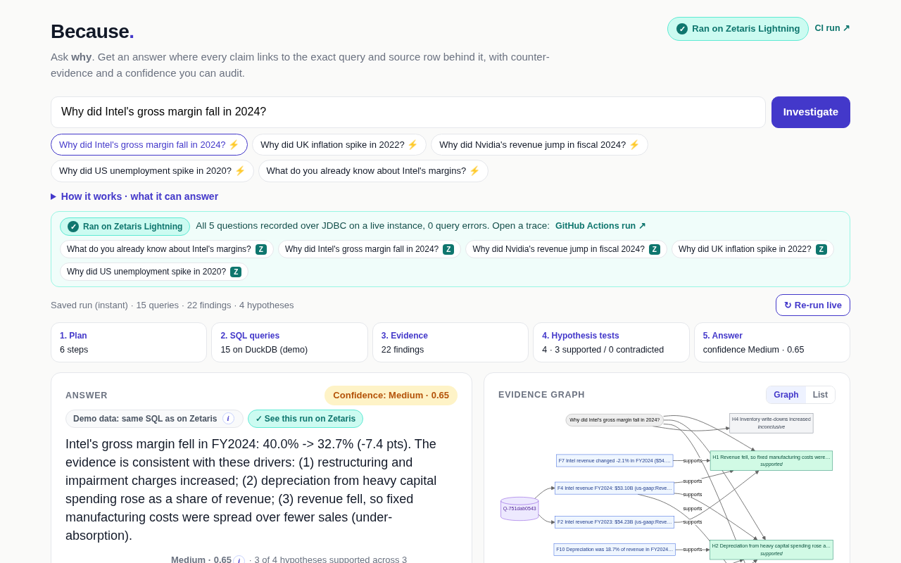

# Because

**The analyst agent that shows its work.** Ask *why* a number moved and get an answer where every claim links to the
exact SQL query and source row behind it, with the explanations that failed and a confidence you can audit.

> **A user story.** A business journalist is filing at 5 pm and her draft says *"Intel's margins collapsed because of
> weak demand"*. She asks Because **"Why did Intel's gross margin fall in 2024?"** About ten seconds later she has:
> 40.0% → 32.7% (-7.4 pts), mostly restructuring and impairment charges (a likely one-off of $6.97B) and higher
> depreciation, with lower revenue a smaller third factor. Each claim cites a finding (`[F15]`); a click shows the SQL and the
> SEC EDGAR row it came from. A federated JOIN of EDGAR revenue with the FRED semiconductor price index shows revenue moved
> against industry prices. She rewrites the sentence and links the trace.

Built for the GenAI Works Open Agent Hackathon 2026, track **The Agent That Can Explain Why**.

| | |
|---|---|
| **Live demo** | [because-agent.vercel.app](https://because-agent.vercel.app) (DuckDB fallback running the same agent SQL; saved runs load instantly, live questions take about 10 s) |
| **Demo video** | [youtu.be/kwpGNsq9gno](https://youtu.be/kwpGNsq9gno) |
| **Runs on real Zetaris** | [CI run 39949595787](https://github.com/OlsOls4/because/actions/runs/39949595787): Zetaris Lightning 2.4.3.1 over JDBC, 5/5 questions, 0 query errors, federated cross-source JOINs, USL model 9/9. Traces: [`examples/zetaris_runs/`](examples/zetaris_runs/) |
| **Evaluation** | [`docs/EVAL.md`](docs/EVAL.md): 19 questions, direction 19/19, reference driver found 16/19, failures committed |
| **Slides** | [`docs/deck/Because-deck.pdf`](docs/deck/Because-deck.pdf) |
| **Sponsor tech, pre-existing code** | [`docs/SPONSORS.md`](docs/SPONSORS.md) |



## Quickstart (one command, no keys)

```bash
git clone https://github.com/OlsOls4/because && cd because && ./scripts/setup.sh && .venv/bin/because ask "Why did UK inflation fall in 2023?"
```

`./scripts/setup.sh` makes a venv, installs, and runs the offline tests (109 pass). Then `.venv/bin/because serve` opens the
web UI at http://127.0.0.1:8000. Python 3.10+. No Zetaris instance or LLM key is needed: the default DuckDB backend runs the
same SQL over the same public endpoints.

## Why it matters

Analysts, journalists, students and investors ask "why did X change?" all the time. LLMs answer fluently but
unverifiably; dashboards show *what* changed but not *why*. Doing it properly means pulling several sources, lining up
periods, testing explanations against each other and writing down what does *not* fit. That takes hours.

Because does that loop in seconds and leaves an audit trail a sceptical reader can check line by line:

- **claims that each link to the exact query and source row** behind them,
- **counter-evidence**: hypotheses that failed their test, one-off items, and what the data cannot explain,
- **a premise check**: "Why did UK inflation *rise* in 2023?" is answered with "it fell", not a made-up story,
- **a calibrated confidence** with its rationale and explicit caps,
- **the full reasoning trace** (plan, queries, findings, hypotheses, answer) and **memory with provenance** across sessions.

The LLM is optional. Every answer is computed from the data first. An LLM may only rewrite those findings into prose, and
that prose is rejected unless every sentence cites a finding and every number appears in the evidence.

## Proof

| What | Result | Evidence |
|---|---|---|
| Real Zetaris Lightning | 5/5 questions on `zetaris-jdbc`, 0 query errors, one federated cross-source JOIN per question where a second source exists | [run 39949595787](https://github.com/OlsOls4/because/actions/runs/39949595787), [`SUMMARY.md`](examples/zetaris_runs/SUMMARY.md) |
| Federated finding | UK CPI tracks the 12-month change in European gas prices **9 months earlier**, r = 0.90 (n = 96 months; same-month r = 0.45): ONS × FRED in one SQL JOIN | [UK trace, F16](examples/zetaris_runs/why-did-uk-inflation-spike-in-2022.md) |
| Zetaris Unified Semantic Layer | `COMPILE USL` + `ACTIVATE USL TABLE` over EDGAR and FRED: 9/9 statements | [`docs/zetaris_usl.sql`](docs/zetaris_usl.sql), [`usl.log`](examples/zetaris_runs/usl.log) |
| Evaluation | direction 19/19 (2/2 false-premise traps caught), reference driver 16/19, mean confidence 0.71 on hits vs 0.52 on misses | [`docs/EVAL.md`](docs/EVAL.md) |
| NVIDIA NIM narration | real narratives from `nvidia/nemotron-3.5-lightning-30b-a3b`, plus one natural rejection by the number-grounding validator | [`examples/outputs/*-narrated*`](examples/outputs/) |
| Meterless conformance | H-MEM 13/13, Scout eval PASS, Markovian conformance ported to pytest | [`conformance/meterless/`](conformance/meterless/) |

## Example (real output, saved in [`examples/outputs/`](examples/outputs/))

> **Why did Intel's gross margin fall in 2024?**
>
> Intel's gross margin fell in FY2024: 40.0% -> 32.7% (-7.4 pts). The evidence is consistent with these drivers:
> (1) restructuring and impairment charges increased; (2) depreciation from heavy capital spending rose as a share of revenue;
> (3) revenue fell, so fixed manufacturing costs were spread over fewer sales (under-absorption).
>
> - Restructuring and impairment charges: up to -6.1 pts. *They rose $7.03B while total cost of sales rose only $3.24B, so at most -6.1 pts can sit in cost of sales; the rest is in operating expenses. $6.97B in FY2024 was over 2.5x the prior-years average: likely one-off.* [F15, F13, F14]
> - Depreciation from heavy capital spending: up to -4.3 pts. [F10, F8, F9]
> - Counter-evidence: driver sizes overlap, so treat each as an upper bound. [F18]
> - Confidence: **Medium (0.65)**. 3 of 4 hypotheses supported across 3 independent cause groups; supported line items add up to ~80% of the change; 87% of queries returned data; capped because the largest driver is a one-off.

| Saved run | Answer | Confidence |
|---|---|---|
| [Why did Intel's gross margin fall in 2024?](examples/outputs/why-did-intel-s-gross-margin-fall-in-2024.md) | charges (one-off), depreciation, lower revenue | Medium 0.65 |
| [Why did UK inflation spike in 2022?](examples/outputs/why-did-uk-inflation-spike-in-2022.md) | household energy, food, weaker pound; wholesale gas leads by 9 months (r=+0.92) | High 0.85 (macro cap) |
| [Why did Nvidia's revenue jump in fiscal 2024?](examples/outputs/why-did-nvidia-s-revenue-jump-in-fiscal-2024.md) | margin expanded with revenue (pricing power), sales outran inventory | High 0.70 (no segment data) |
| [Why did US unemployment spike in 2020?](examples/outputs/why-did-us-unemployment-spike-in-2020.md) | leisure and hospitality collapse, jobless claims, industrial production | High 0.85 (macro cap) |
| [UK inflation 2022, narrated by NVIDIA NIM](examples/outputs/why-did-uk-inflation-spike-in-2022-narrated.md) | validated narrative over the same findings | High 0.85 |
| [What do you already know about Intel's margins?](examples/outputs/memory-recall-intel.md) | H-MEM recall with provenance from the earlier session | n/a |
| [Prompt injection attempt](examples/outputs/guard-blocked.json) | refused by Scout's guard before any tool ran | n/a |

Each run has a Markdown trace (readable) and a JSON trace (complete: every query, SQL, row, finding, hypothesis, contract and memory write).

## Architecture


**One investigation, step by step**

1. **Scout** classifies the question against Because's intent registry ([`because/agent/intents.json`](because/agent/intents.json)),
   runs the guard stack (prompt injection, control bytes, role and surface), binds parameters (company via SEC's ticker
   list, metric, year, country), asks for clarification if something required is missing, and issues an
   **HMAC-signed execution contract** scoped to `harness.query, background.search, memory.recall, memory.write, llm.narrate`, with a 5-minute TTL.
   The analyst calls `scout.enforce(contract, capability)` before every tool use.
2. **H-MEM recall**: what does it already believe about this, and from which query?
3. **Playbook**: pull the target and its drivers through the harness, check the premise ("did it actually fall?"),
   then test each hypothesis with an explicit numeric rule:
   - *company*: a bridge in percentage points of revenue (margins) or dollars (profit). A driver that grew more than cost of sales can only partly explain gross margin, and the answer says so.
   - *macro*: direction and size of each driver's move against a baseline, plus best lead correlation (lag 0-9 months). Policy and labour conditions are tested as enabling factors.
4. **Context** from Wikipedia (GDELT optional) can corroborate a supported hypothesis. It never supplies a number.
5. **Answer**: claims ranked by size, each with `[F#]` citations; counter-evidence (contradicted, weak, unexplained remainder);
   confidence = f(coverage of the move, data completeness, corroboration, contradictions, premise check).
6. **Optional LLM narrative**, validated by [`validate_narrative`](because/agent/analyst.py).
7. **H-MEM write**: every finding becomes a memory with provenance `{origin: harness_query, query_id, sql, rows, source_url, backend}`,
   the conclusion is stored with `derivedFrom` lineage, then a **conflict scan** flags restated numbers against prior beliefs.

## Sponsor technology

Details, and every pre-existing component, are in [`docs/SPONSORS.md`](docs/SPONSORS.md).

### Zetaris: the federated data harness
- `DataHarness` ([`because/harness/base.py`](because/harness/base.py)) with **`ZetarisBackend`** as primary
  ([`zetaris_backend.py`](because/harness/zetaris_backend.py)): JDBC through `jaydebeapi` and the bundled Lightning driver, plus UI-proxy and REST channels (`ZETARIS_CHANNEL=auto`).
- Sources registered the cookbook way: SEC EDGAR and ONS as `CREATE LIGHTNING REST TABLE` + `CACHE TABLE` + `CREATE SCHEMASTORE VIEW ... LATERAL VIEW explode(...)`;
  FRED (no API key) as `CREATE LIGHTNING FILESTORE TABLE ... FORMAT CSV`. Full SQL: [`docs/zetaris_ddl.sql`](docs/zetaris_ddl.sql).
- **Federation in one statement.** [`because/agent/federated.py`](because/agent/federated.py) runs one cross-source SQL JOIN per question:
  EDGAR revenue × FRED semiconductor PPI for companies (price-adjusted revenue), and ONS CPI × FRED European gas for UK inflation
  (lead correlation via a `LAG` window). US unemployment has no second source in the playbook, so it is skipped there.
- **Unified Semantic Layer**: [`docs/zetaris_usl.sql`](docs/zetaris_usl.sql) compiles a USL model over the registered EDGAR and FRED tables (9/9 statements in CI).
- **Live in CI**: [`zetaris-e2e`](.github/workflows/zetaris-e2e.yml) boots the Hobby Docker bundle on a GitHub runner and asks every example question with
  `--backend zetaris --strict`. Latest green run: [39949595787](https://github.com/OlsOls4/because/actions/runs/39949595787). Guide: [`docs/ZETARIS.md`](docs/ZETARIS.md).
- Agent SQL is portable ANSI, so the identical queries run on the DuckDB fallback (the public demo uses it, and the UI says so).

### Meterless: routing, guarding and memory with provenance
- **Scout Intent** ([`because/meterless/scout.py`](because/meterless/scout.py)): intent registry, five-layer guard, clarification triggers and an
  **HMAC-signed execution contract**; the analyst calls `scout.enforce(contract, capability)` before every tool. Official eval harness: PASS on corpus v1
  (a 32-example smoke set, so conformance rather than a benchmark).
- **H-MEM** ([`because/meterless/hmem.py`](because/meterless/hmem.py)): every finding is a memory with provenance `{query_id, sql, rows, source_url, backend}`;
  conflict scan, trust ledger, preview-first dreaming and sleep. Official conformance runner: **13/13**.
- **Meterless Runtime provider** in [`because/llm.py`](because/llm.py) (OpenAI-compatible, `--llm meterless`): implemented from the Meterless provider guide,
  **not tested against a live runtime**.
- **Markovian** ([`because/meterless/markovian.py`](because/meterless/markovian.py)): a library port with the upstream conformance checks ported to pytest.
  It is **not wired into narration**: a trial with NIM produced text the validator rejected.

### NVIDIA NIM
- First-choice LLM provider (`NVIDIA_API_KEY`, default `nvidia/nemotron-3.5-lightning-30b-a3b`; `meta/llama-3.3-70b-instruct` is end-of-life on build.nvidia.com).
  Used for the optional narrative and as a fallback question parser. Groq, Gemini and Meterless are drop-in alternatives.
- Real outputs: [UK inflation 2022](examples/outputs/why-did-uk-inflation-spike-in-2022-narrated.md) and [Nvidia revenue](examples/outputs/why-did-nvidia-s-revenue-jump-in-fiscal-2024-narrated.md)
  (Nemotron 3.5 Lightning). [Intel gross margin](examples/outputs/why-did-intel-s-gross-margin-fall-in-2024-narrated-rejected.md) shows a natural rejection
  (model `nvidia/nemotron-3-ultra-550b-a55b`): it computed "$7.03 billion" and quoted "6.1 points", numbers that are not in any finding, so the deterministic answer was shown instead.
- CI and the public demo use no LLM. With no key, Because runs fully deterministic.

### Cursor
- [`AGENTS.md`](AGENTS.md) and [`.cursor/rules/`](.cursor/rules/) steer agent runs. v0.1 was written with AI coding agents inside the build window and committed once
  (22 Oct 10:51 UTC); later features were refined in three headless Cursor Agent CLI sessions, logged with prompts, tool calls and raw event streams in
  [`docs/cursor-sessions/`](docs/cursor-sessions/). The latest reasoning, federation and NIM fixes were made without Cursor.

## Setup

Requires Python 3.10+. Everything is free; no keys are needed for the default setup.

```bash
git clone https://github.com/OlsOls4/because && cd because
./scripts/setup.sh                       # venv + install + offline tests
.venv/bin/because ask "Why did UK inflation spike in 2022?"
.venv/bin/because serve                  # http://127.0.0.1:8000
```

Or by hand: `python -m venv .venv && . .venv/bin/activate && pip install -e ".[dev]" && cp .env.example .env.local`.
Set `BECAUSE_USER_AGENT="your-app you@example.com"` (SEC asks for a contact).

No Zetaris instance? Set `SAMPLE_MODE=1` (the default backend is DuckDB anyway): the identical agent SQL runs locally over the same public endpoints.

**Zetaris backend** (local Lightning via Docker, JDBC): `./scripts/zetaris_setup.sh ~/Downloads/zetaris-platform.zip`, then `because serve`.
See [`docs/ZETARIS.md`](docs/ZETARIS.md).

**Zetaris in GitHub Actions** (no local Docker needed): fork, add repository secrets `ZETARIS_BUNDLE_URL` (a direct download URL for your
`zetaris-platform.zip`), `ZETARIS_ACR_USER` and `ZETARIS_ACR_PASSWORD` (the registry login from the Zetaris download page), then run
**Actions → zetaris-e2e → Run workflow**. The bundle and its `.env` are never committed. Artifacts: traces (`*.md`, `*.json`), `SUMMARY.md`, `register.log`,
`SHOW LIGHTNING TABLES` output and the compose logs of all seven services.

**LLM narrative (optional)**: put one of `NVIDIA_API_KEY`, `GROQ_API_KEY`, `GEMINI_API_KEY` in `.env.local`, or pass `--llm nvidia|groq|gemini|meterless`.

## Usage

```bash
because ask "Why did Intel's gross margin fall in 2024?"            # summary + citations
because ask "..." --md trace.md --json trace.json                   # full trace
because ask "..." --backend zetaris --strict                        # fail instead of falling back
because ask "..." --llm nvidia                                      # validated NIM narrative (needs NVIDIA_API_KEY)
python scripts/eval.py                                              # 19-question evaluation (docs/EVAL.md)
because ask "What do you already know about Intel's margins?"       # memory recall with provenance
because memory list "inflation"                                     # stored beliefs
because memory why <memory-id>                                      # provenance + audit trail
because memory feedback <memory-id>:wrong                           # -0.20 confidence, flagged for review
because memory dream | sleep | conflicts                            # H-MEM maintenance (preview-first)
because zetaris ping | register | ddl
because examples                                                    # regenerate examples/outputs
because serve
```

**Web UI** ([live demo](https://because-agent.vercel.app)): a pipeline strip (plan → Zetaris SQL → evidence → hypothesis tests → answer) with counts,
a backend badge (Zetaris Lightning vs DuckDB fallback), a Meterless card (Scout intent, signed contract, capabilities, H-MEM recall/writes/conflicts),
question box and example chips (saved runs load instantly; shift-click re-runs live), answer card with clickable
citations, the evidence graph (question -> hypotheses -> findings -> queries), and tabs for evidence, hypotheses, queries (SQL + source URLs),
reasoning trace, Scout contract and memory (with feedback buttons and a "why?" audit view).

**What it can answer today**: company metrics (revenue, gross margin, operating margin, operating income, net income) for any SEC filer;
macro: UK and US inflation, US and UK unemployment. Other questions get a clarification or a polite scope message.

## Tests

```bash
pytest -q            # 109 offline tests: H-MEM and Markovian conformance ports, Scout, harness (Zetaris flows with fake channels), confidence monotonicity, narrative validator, web API, end-to-end analyst
pytest -m live       # live SEC/ONS/FRED checks
bash conformance/meterless/run.sh   # official Meterless suites
```

## Dependencies

`duckdb`, `httpx`, `fastapi`, `uvicorn`, `python-dotenv` (MIT/BSD/Apache). Optional: `JayDeBeApi` + `JPype1` and a JDK 11+ for Zetaris JDBC.
UI loads `mermaid` from jsDelivr. Data: SEC EDGAR (public), ONS (Open Government Licence), FRED (St. Louis Fed; series have their own terms,
cite FRED), Wikipedia (CC BY-SA), GDELT (free with citation).

## Pre-existing components (declared per hackathon rules)

- **Free research add-on from [`OlsOls4/ollymcbride-bot`](https://github.com/OlsOls4/ollymcbride-bot)** (`metaculus_bot/research/free_sources.py`, written
  before 22 Oct 2026 00:00 UTC by the same author). [`because/research/background.py`](because/research/background.py) adapts its ideas: GDELT DOC 2.0 query
  with a process-wide 5 s rate gate, Wikipedia search with a descriptive User-Agent, fail-soft behaviour.
- **Meterless engine specs and test vectors** (Apache-2.0, [github.com/Meterless/Meterless](https://github.com/Meterless/Meterless)): the H-MEM and
  Scout specs were implemented here from scratch in Python. `tests/fixtures/meterless_hmem_vectors.json` is copied unmodified, and the official runners are
  invoked, not vendored.
- **Zetaris getting-started docs** ([zetaris/getting-started](https://github.com/zetaris/getting-started)): the JDBC/REST channel shapes and the
  Lightning REST-table pattern follow their scripts and cookbooks.

Everything else in this repository was written during the hackathon (from 22 Oct 2026).

## Limitations

- **Co-movement is not causation.** Macro tests check direction, size and timing (lead correlation); CPI component weights are not applied, so macro confidence is capped at 0.85.
- **No segment, unit or price data** in SEC companyfacts. Revenue "why" answers are indirect (capped at 0.70), and all three eval misses are of this kind:
  Tesla gross margin 2023 (price cuts), Apple revenue FY2023 (Mac/iPad and FX), Intel revenue 2023 (PC/server demand). See [`docs/EVAL.md`](docs/EVAL.md).
- **XBRL does not say** whether a charge sits in cost of sales or operating expenses, so bridge contributions are upper bounds when lines overlap.
- **Scope**: company metrics for SEC filers; UK/US inflation and unemployment. Other questions get a clarification or a plain scope message.
- **The public demo runs on the DuckDB fallback**, not Zetaris (no hosted instance); the Zetaris runs are recorded from CI and viewable in the UI.
- The eval is 19 questions with author-written references from filings and releases: a sanity check, not a benchmark.
- The Meterless Runtime provider is untested against a live runtime; Markovian is a library, not part of the answer path.

## Next steps

- Segment revenue from XBRL frames and an FX series, to close the three eval misses.
- CPI component weights (ONS), so macro drivers can be sized as shares of the move.
- Route the agent's own queries through the USL model, and add more countries (Eurostat is already a Zetaris cookbook source).
- Wire Markovian into multi-company comparisons once its output passes the narrative validator.

## Licence

MIT. See [LICENSE](LICENSE).
