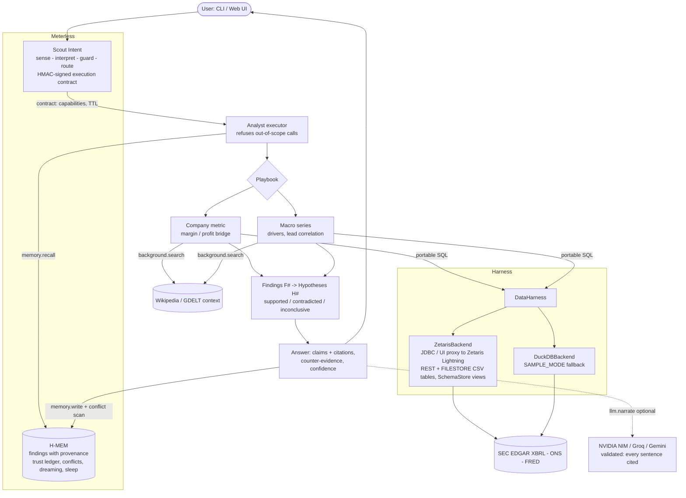

# Because

**The analyst agent that shows its work.** Ask *why* something happened ("Why did Intel's gross margin fall in 2024?",
"Why did UK inflation spike in 2022?"). Because investigates several public data sources through a federated SQL
harness, tests competing explanations, and answers with:

- **claims that each link to the exact query and source row** behind them,
- **counter-evidence**: hypotheses that failed their test, and what the data cannot explain,
- **a confidence score with its rationale**,
- **the full reasoning trace**: plan, queries, findings, hypotheses tested, answer,
- **memory with provenance**, so later it can explain *why it believes* something, across sessions.

Built for the GenAI Works Open Agent Hackathon 2026, track **The Agent That Can Explain Why**.

**Try it:** [because-agent.vercel.app](https://because-agent.vercel.app) (public demo in `SAMPLE_MODE`: the same agent and SQL on the DuckDB fallback; saved runs load instantly, live questions take about 10 s).
**Demo video (3 min):** [youtu.be/7SHfgPPmVMQ](https://youtu.be/7SHfgPPmVMQ) · **Slides:** [`docs/deck/Because-deck.pdf`](docs/deck/Because-deck.pdf) ([PPTX](docs/deck/Because-deck.pptx)) · **Sponsor tech and pre-existing components:** [`docs/SPONSORS.md`](docs/SPONSORS.md)
**Real Zetaris:** [`zetaris-e2e` workflow](.github/workflows/zetaris-e2e.yml) boots the Zetaris Lightning Docker bundle on a GitHub runner and runs the agent over JDBC; traces land in [`examples/zetaris_runs/`](examples/zetaris_runs/).

   

## The problem and who it is for

Analysts, journalists, students and investors ask "why did X change?" all the time. LLMs answer fluently but
unverifiably; dashboards show *what* changed but not *why*. Doing it properly means pulling several sources,
lining up periods, testing explanations against each other and writing down what does *not* fit. That takes hours.

Because does that loop in seconds and leaves an audit trail a sceptical reader can check line by line. The LLM is
optional: every answer is computed from the data first, and an LLM may only rewrite those findings into prose, which
is rejected unless every sentence cites a finding and every number appears in the evidence.

## Example (real output, saved in [`examples/outputs/`](examples/outputs/))

> **Why did Intel's gross margin fall in 2024?**
>
> Intel's gross margin fell in FY2024: 40.0% -> 32.7% (-7.4 pts). The evidence points mainly to (1) restructuring and
> impairment charges increased; (2) depreciation from heavy capital spending rose as a share of revenue; (3) revenue
> fell, so fixed manufacturing costs were spread over fewer sales.
>
> - Restructuring and impairment charges: up to -6.1 pts. *They rose $7.03B while total cost of sales rose only $3.24B, so at most -6.1 pts can sit in cost of sales; the rest is in operating expenses.* [F15, F13, F14, F4, F2, F16]
> - Depreciation: 14.5% -> 18.7% of revenue, up to -4.3 pts, on capex of 45% of revenue. [F10, F8, F9, F4, F2, F11, F12]
> - Counter-evidence: driver sizes overlap, so treat each as an upper bound. [F18]
> - Confidence: **High (0.74)**. 3 of 4 hypotheses supported; supported drivers cover about 80% of the move; 87% of queries returned data.
>
> F13 = *Intel restructuring and impairment charges FY2024: $6.97B (us-gaap:RestructuringSettlementAndImpairmentProvisions, 10-K filed 2026-01-23)*, query `Q-16384213e5` row 46, `https://data.sec.gov/api/xbrl/companyconcept/CIK0000050863/us-gaap/RestructuringSettlementAndImpairmentProvisions.json`

| Saved run | Answer | Confidence |
|---|---|---|
| [Why did Intel's gross margin fall in 2024?](examples/outputs/why-did-intel-s-gross-margin-fall-in-2024.md) | charges, depreciation, lower revenue | High 0.74 |
| [Why did UK inflation spike in 2022?](examples/outputs/why-did-uk-inflation-spike-in-2022.md) | wholesale gas (r=+0.92, 9-month lead), household energy, food; looser money and a tight labour market as enabling conditions | High 0.94 |
| [Why did Nvidia's revenue jump in fiscal 2024?](examples/outputs/why-did-nvidia-s-revenue-jump-in-fiscal-2024.md) | margin expanded with revenue (pricing power), sales outran inventory; capped at 0.70 because there is no segment data | High 0.70 |
| [Why did US unemployment spike in 2020?](examples/outputs/why-did-us-unemployment-spike-in-2020.md) | jobless claims, leisure and hospitality collapse; **contradicted**: tight monetary policy | High 0.91 |
| [What do you already know about Intel's margins?](examples/outputs/memory-recall-intel.md) | H-MEM recall with provenance from the earlier session | n/a |
| [Prompt injection attempt](examples/outputs/guard-blocked.json) | refused by Scout's guard before any tool ran | n/a |

Each run has a Markdown trace (readable) and a JSON trace (complete: every query, SQL, row, finding, hypothesis, contract and memory write).

## Architecture



**One investigation, step by step**

1. **Scout** classifies the question against Because's intent registry ([`because/agent/intents.json`](because/agent/intents.json)),
   runs the guard stack (prompt injection, control bytes, role and surface), binds parameters (company via SEC's ticker
   list, metric, year, country), asks for clarification if something required is missing, and issues an
   **HMAC-signed execution contract** scoped to `harness.query, background.search, memory.recall, memory.write, llm.narrate`, with a 5-minute TTL.
   The analyst calls `scout.enforce(contract, capability)` before every tool use.
2. **H-MEM recall**: what does it already believe about this, and from which query?
3. **Playbook**: pull the target and its drivers through the harness, check the premise ("did it actually fall?"),
   then test each hypothesis with an explicit numeric rule:
   - *company*: a bridge in percentage points of revenue (margins) or dollars (profit). A driver that grew more than cost of sales can only partly explain gross margin, and the answer says so.
   - *macro*: direction and size of each driver's move against a baseline, plus best lead correlation (lag 0-9 months). Policy and labour conditions are tested as enabling factors.
4. **Context** from Wikipedia (GDELT optional) can corroborate a supported hypothesis. It never supplies a number.
5. **Answer**: claims ranked by size, each with `[F#]` citations; counter-evidence (contradicted, weak, unexplained remainder);
   confidence = f(coverage of the move, data completeness, corroboration, contradictions, premise check).
6. **Optional LLM narrative**, validated by [`validate_narrative`](because/agent/analyst.py).
7. **H-MEM write**: every finding becomes a memory with provenance `{origin: harness_query, query_id, sql, rows, source_url, backend}`,
   the conclusion is stored with `derivedFrom` lineage, then a **conflict scan** flags restated numbers against prior beliefs.

## Sponsor technology

### Zetaris: the data harness
- `DataHarness` contract ([`because/harness/base.py`](because/harness/base.py)) with **`ZetarisBackend`** as primary
  ([`zetaris_backend.py`](because/harness/zetaris_backend.py)): JDBC through `jaydebeapi` and the bundled Lightning driver
  (`com.zetaris.lightning.jdbc.LightningDriver`, `jdbc:zetaris:lightning@localhost:10000`), plus an optional REST channel.
- Sources are registered the way the Zetaris cookbooks do it: `CREATE LIGHTNING REST TABLE` (raw JSON) + `CREATE SCHEMASTORE VIEW ... LATERAL VIEW explode(...)`
  into canonical columns ([`sources.zetaris_ddl`](because/harness/sources.py), full SQL in [`docs/zetaris_ddl.sql`](docs/zetaris_ddl.sql)).
  New companies are registered lazily on first question. Existing views are reused, never dropped.
- Agent SQL is portable ANSI, so the identical queries run on the **DuckDB fallback** over the same endpoints (no instance needed).
- **FRED without an API key** goes through Zetaris too, as **Lightning FILESTORE CSV tables** (`CREATE LIGHTNING FILESTORE TABLE ... FORMAT CSV`
  in a `BECAUSE_FILES` database, flattened by a SchemaStore view), so all three source families are federated by Lightning.
  Raw REST tables are `CACHE TABLE`d right after registration (the cookbook's advice: uncached REST tables re-fetch the endpoint on every query).
- Three channels: **JDBC** (default), the **UI proxy** (`/api/proxy/sql-editor/sqls/run-query` after `/api/auth/login`, as the bundle's `verify.sh` does), and the API-key REST channel; `ZETARIS_CHANNEL=auto` tries JDBC then the UI proxy.
- **One-command local setup** for the free Hobby tier: [`scripts/zetaris_setup.sh`](scripts/zetaris_setup.sh), documented in [`docs/ZETARIS.md`](docs/ZETARIS.md).
- **Runs on a real Zetaris instance in CI**: [`.github/workflows/zetaris-e2e.yml`](.github/workflows/zetaris-e2e.yml) downloads the bundle, starts the
  seven containers on `ubuntu-latest`, waits for `verify.sh`, registers every source, asks the example questions with `--backend zetaris --strict`, and uploads traces,
  DDL logs and compose logs. Recorded runs: [`examples/zetaris_runs/`](examples/zetaris_runs/).

### Meterless: context engines (implemented from their AGENTS.md specs)
- **H-MEM** ([`because/meterless/hmem.py`](because/meterless/hmem.py)): canonical record with mandatory source and provenance, tiered layers,
  hybrid retrieval with the canonical formula (threshold 0.35, top 5), domain-grouped reinjection, exact feedback deltas,
  an append-only trust ledger (17 actions), conflict detection with the 0.70 auto-resolve gate (losers superseded, never deleted),
  dreaming behind an approval boundary, and a preview-first sleep cycle with guardrails, backup and restore.
  **Official conformance runner: 13/13 passed** ([`conformance/meterless/hmem-scorecard.txt`](conformance/meterless/hmem-scorecard.txt)), run unmodified
  through a TypeScript adapter that drives the Python engine, plus a pytest port of the same vectors.
- **Scout Intent** ([`because/meterless/scout.py`](because/meterless/scout.py)): registry with mandatory examples, stage-1 lexical scan with the 16 ms
  self-test, local stage-2 semantic rescoring, canonical weights and bands, four clarification triggers, a five-layer guard,
  capability-graph routing (local-first), model-profile routing, and HMAC-SHA256 contracts with TTL, verification, scope enforcement and replan lineage.
  **Official eval harness: PASS** on corpus v1 (top-1 1.00, top-3 1.00, injection precision and recall 1.00, tool precision 1.00, clarification rate 0.03):
  [`conformance/meterless/scout-eval-report.md`](conformance/meterless/scout-eval-report.md). The v1 corpus is a 32-example smoke set,
  and many prompts match the fixture registry's own examples, so treat this as conformance, not a benchmark.
- Reproduce both: `bash conformance/meterless/run.sh` (clones Meterless, needs Node 18+).
- Not used yet: Markovian (flat-cost reasoning) and World Model. See Next steps.

### NVIDIA
- **NVIDIA NIM** (build.nvidia.com, OpenAI-compatible) is the first-choice LLM provider (`NVIDIA_API_KEY`, default `meta/llama-3.3-70b-instruct`),
  used for the validated narrative and as a fallback question parser. Groq and Gemini are drop-in alternatives ([`because/llm.py`](because/llm.py)).
  Scout's model profiles route to these with data-class clearance. With no key, Because runs fully deterministic.

### Cursor
- Set up as a **Cursor** project: [`AGENTS.md`](AGENTS.md) plus project rules in [`.cursor/rules/`](.cursor/rules/) (evidence-first rules,
  portable SQL, contract enforcement, Zetaris conventions) steer every Cursor agent run. v0.1 was written with AI coding
  agents inside the build window and committed in one go (22 Oct 10:51 UTC); later features were built in Cursor sessions, logged below.
- The **Cursor Agent CLI** (`cursor-agent -p --force --output-format stream-json`, headless with a Cursor user API key) did real work on this repo.
  Each session's prompt, tool calls, final message and raw event stream are in [`docs/cursor-sessions/`](docs/cursor-sessions/):
  1. [Zetaris backend hardening](docs/cursor-sessions/01-zetaris-backend-hardening.md): UI-proxy channel, `auto` channel fallback, `CACHE TABLE`, EDGAR 404 as empty table, JDBC column-label normalisation, 12 new tests.
  2. [FRED as FILESTORE CSV tables + `because zetaris sql`](docs/cursor-sessions/02-fred-filestore-and-sql-cli.md) (stopped by the free plan's usage limit; one test fixed by hand, noted in the log).
  3. [Web UI polish](docs/cursor-sessions/03-web-ui-polish.md): pipeline strip, Meterless card, Zetaris badge, citation tooltips, recorded-Zetaris-run chips, `tests/test_web.py`.

## Setup

Requires Python 3.10+. Everything is free; no keys are needed for the default setup.

```bash
git clone https://github.com/OlsOls4/because && cd because
./scripts/setup.sh                       # venv + install + offline tests
.venv/bin/because ask "Why did UK inflation spike in 2022?"
.venv/bin/because serve                  # http://127.0.0.1:8000
```

Or by hand: `python -m venv .venv && . .venv/bin/activate && pip install -e ".[dev]" && cp .env.example .env.local`.
Set `BECAUSE_USER_AGENT="your-app you@example.com"` (SEC asks for a contact).

No Zetaris instance? Set `SAMPLE_MODE=1` (the default backend is DuckDB anyway): the identical agent SQL runs locally over the same public endpoints.

**Zetaris backend** (local Lightning via Docker, JDBC): `./scripts/zetaris_setup.sh ~/Downloads/zetaris-platform.zip`, then `because serve`.
See [`docs/ZETARIS.md`](docs/ZETARIS.md).

**Zetaris in GitHub Actions** (no local Docker needed): fork, add repository secrets `ZETARIS_BUNDLE_URL` (a direct download URL for your
`zetaris-platform.zip`), `ZETARIS_ACR_USER` and `ZETARIS_ACR_PASSWORD` (the registry login from the Zetaris download page), then run
**Actions → zetaris-e2e → Run workflow**. The bundle and its `.env` are never committed. Artifacts: traces (`*.md`, `*.json`), `SUMMARY.md`, `register.log`,
`SHOW LIGHTNING TABLES` output and the compose logs of all seven services.

**LLM narrative (optional)**: put one of `NVIDIA_API_KEY`, `GROQ_API_KEY`, `GEMINI_API_KEY` in `.env.local`.

## Usage

```bash
because ask "Why did Intel's gross margin fall in 2024?"            # summary + citations
because ask "..." --md trace.md --json trace.json                   # full trace
because ask "..." --backend zetaris --strict                        # fail instead of falling back
because ask "What do you already know about Intel's margins?"       # memory recall with provenance
because memory list "inflation"                                     # stored beliefs
because memory why <memory-id>                                      # provenance + audit trail
because memory feedback <memory-id>:wrong                           # -0.20 confidence, flagged for review
because memory dream | sleep | conflicts                            # H-MEM maintenance (preview-first)
because zetaris ping | register | ddl
because examples                                                    # regenerate examples/outputs
because serve
```

**Web UI** ([live demo](https://because-agent.vercel.app)): a pipeline strip (plan → Zetaris SQL → evidence → hypothesis tests → answer) with counts,
a backend badge (Zetaris Lightning vs DuckDB fallback), a Meterless card (Scout intent, signed contract, capabilities, H-MEM recall/writes/conflicts),
question box and example chips (saved runs load instantly; shift-click re-runs live), answer card with clickable
citations, the evidence graph (question -> hypotheses -> findings -> queries), and tabs for evidence, hypotheses, queries (SQL + source URLs),
reasoning trace, Scout contract and memory (with feedback buttons and a "why?" audit view).

**What it can answer today**: company metrics (revenue, gross margin, operating margin, operating income, net income) for any SEC filer;
macro: UK and US inflation, US and UK unemployment. Other questions get a clarification or a polite scope message.

## Tests

```bash
pytest -q            # 58 offline tests: H-MEM conformance port, Scout, harness (Zetaris JDBC/UI/file-store flows with fake channels), web API, end-to-end analyst
pytest -m live       # live SEC/ONS/FRED checks
bash conformance/meterless/run.sh   # official Meterless suites
```

## Dependencies

`duckdb`, `httpx`, `fastapi`, `uvicorn`, `python-dotenv` (MIT/BSD/Apache). Optional: `JayDeBeApi` + `JPype1` and a JDK 11+ for Zetaris JDBC.
UI loads `mermaid` from jsDelivr. Data: SEC EDGAR (public), ONS (Open Government Licence), FRED (St. Louis Fed; series have their own terms,
cite FRED), Wikipedia (CC BY-SA), GDELT (free with citation).

## Pre-existing components (declared per hackathon rules)

- **Free research add-on from [`OlsOls4/ollymcbride-bot`](https://github.com/OlsOls4/ollymcbride-bot)** (`metaculus_bot/research/free_sources.py`, written
  before 22 Oct 2026 00:00 UTC by the same author). [`because/research/background.py`](because/research/background.py) adapts its ideas: GDELT DOC 2.0 query
  with a process-wide 5 s rate gate, Wikipedia search with a descriptive User-Agent, fail-soft behaviour.
- **Meterless engine specs and test vectors** (Apache-2.0, [github.com/Meterless/Meterless](https://github.com/Meterless/Meterless)): the H-MEM and
  Scout specs were implemented here from scratch in Python. `tests/fixtures/meterless_hmem_vectors.json` is copied unmodified, and the official runners are
  invoked, not vendored.
- **Zetaris getting-started docs** ([zetaris/getting-started](https://github.com/zetaris/getting-started)): the JDBC/REST channel shapes and the
  Lightning REST-table pattern follow their scripts and cookbooks.

Everything else in this repository was written during the hackathon (from 22 Oct 2026).

## Limitations

- EDGAR `companyfacts` has no segment data, so revenue "why" answers are indirect (confidence capped at 0.70). XBRL does not say whether a charge sits
  in cost of sales or operating expenses; the bridge reports upper bounds when lines overlap.
- Macro tests show co-movement and timing, not causation. CPI component weights are not applied yet.
- Background context is Wikipedia sentence matching. GDELT only covers recent months and is off by default (shared rate limit).

## Next steps

- Add a **Unified Semantic Layer** (`COMPILE USL`) model joining EDGAR facts and macro series.
- **Markovian** engine for long investigations (bounded state between hypothesis rounds) and multi-company comparisons.
- CPI component weights (ONS), segment revenue from XBRL frames, more countries (Eurostat is already a Zetaris cookbook source).
- A dreaming pass that proposes cross-question insights ("energy shocks explain both UK and euro-area inflation") for approval in the UI.

## Licence

MIT. See [LICENSE](LICENSE).
