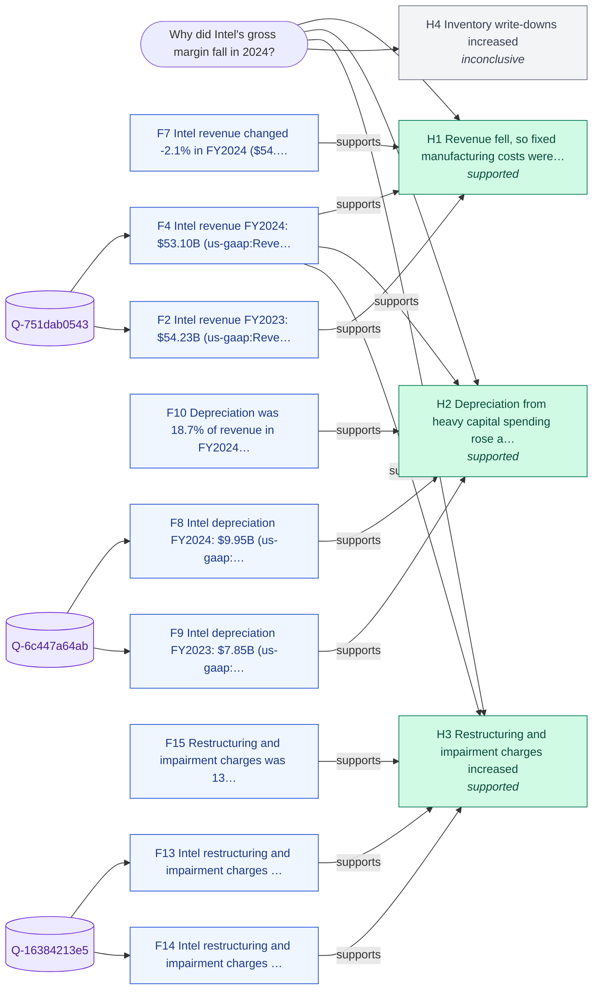

# Why did Intel's gross margin fall in 2024?

_Backend: **duckdb** · LLM: none · started 2026-10-23T09:47:11Z_

## Answer

Intel's gross margin fell in FY2024: 40.0% -> 32.7% (-7.4 pts). The evidence is consistent with these drivers: (1) restructuring and impairment charges increased; (2) depreciation from heavy capital spending rose as a share of revenue; (3) revenue fell, so fixed manufacturing costs were spread over fewer sales (under-absorption).

**Confidence: Medium (0.65)** - 3 of 4 hypotheses supported across 3 independent cause group(s); supported line items add up to ~80% of the change (bridge); 87% of queries returned data; 0 context corroborations; largest driver is a one-off item.

## Because

- **Restructuring and impairment charges increased** - Accounts for up to -6.1 pts of the -7.4 pts move. It rose $7.03B while total cost of sales rose only $3.24B, so at most -6.1 pts can sit in cost of sales; the rest is in operating expenses (XBRL does not say where). One-off: Restructuring and impairment charges of $6.97B in FY2024 were over 2.5x the prior-years average ($855.3M): a large single-year charge, likely one-off. [F15, F13, F14, F4, F2, F16]
- **Depreciation from heavy capital spending rose as a share of revenue** - Accounts for up to -4.3 pts of the -7.4 pts move. [F10, F8, F9, F4, F2, F11, F12]
- **Revenue fell, so fixed manufacturing costs were spread over fewer sales (under-absorption)** - Revenue moved -2.1%, in the same direction as the target. [F7, F4, F2]

## Counter-evidence and limits

- One-off item: Restructuring and impairment charges increased. Restructuring and impairment charges of $6.97B in FY2024 were over 2.5x the prior-years average ($855.3M): a large single-year charge, likely one-off. [F15, F13, F14]
- Driver sizes overlap: treat each one's contribution as an upper bound. [F18]

## Caveats

- Values are the latest filed (as-restated) figures per period; XBRL tags vary by company and year.
- Context snippets from Wikipedia corroborate hypotheses but never supply numbers.

## Hypotheses tested

| # | Hypothesis | Test | Verdict | Detail |
|---|---|---|---|---|
| H1 | Revenue fell, so fixed manufacturing costs were spread over fewer sales (under-absorption) | Revenue change FY-1 -> FY (threshold +/-2%) | **supported** | Revenue moved -2.1%, in the same direction as the target. |
| H2 | Depreciation from heavy capital spending rose as a share of revenue | Change in depreciation / revenue (pts) | **supported** | Accounts for up to -4.3 pts of the -7.4 pts move. |
| H3 | Restructuring and impairment charges increased | Change in restructuring+impairment / revenue (pts) | **supported** | Accounts for up to -6.1 pts of the -7.4 pts move. It rose $7.03B while total cost of sales rose only $3.24B, so at most -6.1 pts can sit in cost of sales; the rest is in operating expenses (XBRL does not say where). |
| H4 | Inventory write-downs increased | Change in inventory write-downs / revenue (pts) | **inconclusive** | EDGAR has no inventory write-downs for FY2023/FY2024 under the concepts tried (InventoryWriteDown). |

## Evidence (every claim's source)

| # | Finding | Kind | Query · rows | Source |
|---|---|---|---|---|
| F1 | Intel gross profit FY2023: $21.71B (us-gaap:GrossProfit, 10-K filed 2026-01-23, period ending 2023-12-30) | data | `Q-c1fe563c7b` · [47] | [link](https://data.sec.gov/api/xbrl/companyconcept/CIK0000050863/us-gaap/GrossProfit.json) |
| F2 | Intel revenue FY2023: $54.23B (us-gaap:RevenueFromContractWithCustomerExcludingAssessedTax, 10-K filed 2026-01-23, period ending 2023-12-30) | data | `Q-751dab0543` · [20] | [link](https://data.sec.gov/api/xbrl/companyconcept/CIK0000050863/us-gaap/RevenueFromContractWithCustomerExcludingAssessedTax.json) |
| F3 | Intel gross profit FY2024: $17.34B (us-gaap:GrossProfit, 10-K filed 2026-01-23, period ending 2024-12-28) | data | `Q-c1fe563c7b` · [49] | [link](https://data.sec.gov/api/xbrl/companyconcept/CIK0000050863/us-gaap/GrossProfit.json) |
| F4 | Intel revenue FY2024: $53.10B (us-gaap:RevenueFromContractWithCustomerExcludingAssessedTax, 10-K filed 2026-01-23, period ending 2024-12-28) | data | `Q-751dab0543` · [22] | [link](https://data.sec.gov/api/xbrl/companyconcept/CIK0000050863/us-gaap/RevenueFromContractWithCustomerExcludingAssessedTax.json) |
| F5 | Intel gross margin FY2023 -> FY2024: 40.0% -> 32.7% (-7.4 pts) | derived |  |  |
| F6 | Gross margin trend: FY2021: 55.4%, FY2022: 42.6%, FY2023: 40.0%, FY2024: 32.7% | derived |  |  |
| F7 | Intel revenue changed -2.1% in FY2024 ($54.23B -> $53.10B) | derived |  |  |
| F8 | Intel depreciation FY2024: $9.95B (us-gaap:Depreciation, 10-K filed 2026-01-23, period ending 2024-12-28) | data | `Q-6c447a64ab` · [49] | [link](https://data.sec.gov/api/xbrl/companyconcept/CIK0000050863/us-gaap/Depreciation.json) |
| F9 | Intel depreciation FY2023: $7.85B (us-gaap:Depreciation, 10-K filed 2026-01-23, period ending 2023-12-30) | data | `Q-6c447a64ab` · [47] | [link](https://data.sec.gov/api/xbrl/companyconcept/CIK0000050863/us-gaap/Depreciation.json) |
| F10 | Depreciation was 18.7% of revenue in FY2024 vs 14.5% in FY2023 (+4.3 pts; $7.85B -> $9.95B) | derived |  |  |
| F11 | Capital expenditure was 45.1% of revenue in FY2024 vs 47.5% in FY2023 ($23.94B vs $25.75B) | derived |  |  |
| F12 | Intel capital expenditure FY2024: $23.94B (us-gaap:PaymentsToAcquirePropertyPlantAndEquipment, 10-K filed 2026-01-23, period ending 2024-12-28) | data | `Q-2b2533f6cf` · [49] | [link](https://data.sec.gov/api/xbrl/companyconcept/CIK0000050863/us-gaap/PaymentsToAcquirePropertyPlantAndEquipment.json) |
| F13 | Intel restructuring and impairment charges FY2024: $6.97B (us-gaap:RestructuringSettlementAndImpairmentProvisions, 10-K filed 2026-01-23, period ending 2024-12-28) | data | `Q-16384213e5` · [46] | [link](https://data.sec.gov/api/xbrl/companyconcept/CIK0000050863/us-gaap/RestructuringSettlementAndImpairmentProvisions.json) |
| F14 | Intel restructuring and impairment charges FY2023: -$62.0M (us-gaap:RestructuringSettlementAndImpairmentProvisions, 10-K filed 2026-01-23, period ending 2023-12-30) | data | `Q-16384213e5` · [44] | [link](https://data.sec.gov/api/xbrl/companyconcept/CIK0000050863/us-gaap/RestructuringSettlementAndImpairmentProvisions.json) |
| F15 | Restructuring and impairment charges was 13.1% of revenue in FY2024 vs -0.1% in FY2023 (+13.2 pts; -$62.0M -> $6.97B) - but cost of sales rose only $3.24B | derived |  |  |
| F16 | Intel goodwill impairment FY2024: $2.98B (us-gaap:GoodwillImpairmentLoss, 10-K filed 2026-01-23, period ending 2024-12-28) | data | `Q-2605e9c456` · [8] | [link](https://data.sec.gov/api/xbrl/companyconcept/CIK0000050863/us-gaap/GoodwillImpairmentLoss.json) |
| F17 | Year-end inventory was 23.0% of revenue in FY2024 vs 20.5% in FY2023 | derived |  |  |
| F18 | Bridge: the identified lines add up to -10.4 pts, more than the -7.4 pts change - they overlap or were partly offset by other cost improvements, so their individual sizes are upper bounds | derived |  |  |
| F19 | Context (Wikipedia, 'Intel'): Intel was the world's third-largest semiconductor chip manufacturer by revenue in 2024 and has been included in the Fortune 500 list of the largest United States corporations by revenue since 2007. | context |  | [link](https://en.wikipedia.org/wiki/Intel) |
| F20 | Context (Wikipedia, 'Intel'): The start of the construction was initially planned for 2023, but this was postponed to late 2024, while the production start was scheduled for 2027. | context |  | [link](https://en.wikipedia.org/wiki/Intel) |
| F21 | Context (Wikipedia, 'Intel'): In December 2023, Intel unveiled Gaudi3, an artificial intelligence (AI) chip for generative AI software which launched in 2024 and competes with rival chips from Nvidia and AMD. | context |  | [link](https://en.wikipedia.org/wiki/Intel) |
| F22 | Context (Wikipedia, 'Intel'): On June 4, 2024, Intel announced AI chips for data centers, the Xeon 6 processor, aiming for better performance and power efficiency compared to its predecessor. | context |  | [link](https://en.wikipedia.org/wiki/Intel) |

## Queries run through the data harness

- `Q-2b2533f6cf` (duckdb, 51 rows) - capital expenditure (PaymentsToAcquirePropertyPlantAndEquipment) annual 10-K facts
  ```sql
  SELECT period_start, period_end, value_usd, form_type, fiscal_period, filed_date, accession_number FROM edgar_concept_0000050863_paymentstoacquirepropertyplantandequipment WHERE form_type = '10-K' AND fiscal_period = 'FY' ORDER BY period_end, filed_date
  ```
  source: `edgar_concept_0000050863_paymentstoacquirepropertyplantandequipment` <- https://data.sec.gov/api/xbrl/companyconcept/CIK0000050863/us-gaap/PaymentsToAcquirePropertyPlantAndEquipment.json
- `Q-16384213e5` (duckdb, 48 rows) - restructuring and impairment charges (RestructuringSettlementAndImpairmentProvisions) annual 10-K facts
  ```sql
  SELECT period_start, period_end, value_usd, form_type, fiscal_period, filed_date, accession_number FROM edgar_concept_0000050863_restructuringsettlementandimpairmentprovisions WHERE form_type = '10-K' AND fiscal_period = 'FY' ORDER BY period_end, filed_date
  ```
  source: `edgar_concept_0000050863_restructuringsettlementandimpairmentprovisions` <- https://data.sec.gov/api/xbrl/companyconcept/CIK0000050863/us-gaap/RestructuringSettlementAndImpairmentProvisions.json
- `Q-96c8f3195d` (duckdb, 0 rows) - cost of sales (CostOfRevenue) annual 10-K facts
  ```sql
  SELECT period_start, period_end, value_usd, form_type, fiscal_period, filed_date, accession_number FROM edgar_concept_0000050863_costofrevenue WHERE form_type = '10-K' AND fiscal_period = 'FY' ORDER BY period_end, filed_date
  ```
  source: `edgar_concept_0000050863_costofrevenue` <- https://data.sec.gov/api/xbrl/companyconcept/CIK0000050863/us-gaap/CostOfRevenue.json
- `Q-bf919c507e` (duckdb, 51 rows) - cost of sales (CostOfGoodsAndServicesSold) annual 10-K facts
  ```sql
  SELECT period_start, period_end, value_usd, form_type, fiscal_period, filed_date, accession_number FROM edgar_concept_0000050863_costofgoodsandservicessold WHERE form_type = '10-K' AND fiscal_period = 'FY' ORDER BY period_end, filed_date
  ```
  source: `edgar_concept_0000050863_costofgoodsandservicessold` <- https://data.sec.gov/api/xbrl/companyconcept/CIK0000050863/us-gaap/CostOfGoodsAndServicesSold.json
- `Q-6c447a64ab` (duckdb, 51 rows) - depreciation (Depreciation) annual 10-K facts
  ```sql
  SELECT period_start, period_end, value_usd, form_type, fiscal_period, filed_date, accession_number FROM edgar_concept_0000050863_depreciation WHERE form_type = '10-K' AND fiscal_period = 'FY' ORDER BY period_end, filed_date
  ```
  source: `edgar_concept_0000050863_depreciation` <- https://data.sec.gov/api/xbrl/companyconcept/CIK0000050863/us-gaap/Depreciation.json
- `Q-2605e9c456` (duckdb, 10 rows) - goodwill impairment (GoodwillImpairmentLoss) annual 10-K facts
  ```sql
  SELECT period_start, period_end, value_usd, form_type, fiscal_period, filed_date, accession_number FROM edgar_concept_0000050863_goodwillimpairmentloss WHERE form_type = '10-K' AND fiscal_period = 'FY' ORDER BY period_end, filed_date
  ```
  source: `edgar_concept_0000050863_goodwillimpairmentloss` <- https://data.sec.gov/api/xbrl/companyconcept/CIK0000050863/us-gaap/GoodwillImpairmentLoss.json
- `Q-c1fe563c7b` (duckdb, 51 rows) - gross profit (GrossProfit) annual 10-K facts
  ```sql
  SELECT period_start, period_end, value_usd, form_type, fiscal_period, filed_date, accession_number FROM edgar_concept_0000050863_grossprofit WHERE form_type = '10-K' AND fiscal_period = 'FY' ORDER BY period_end, filed_date
  ```
  source: `edgar_concept_0000050863_grossprofit` <- https://data.sec.gov/api/xbrl/companyconcept/CIK0000050863/us-gaap/GrossProfit.json
- `Q-6c6b3b7b94` (duckdb, 34 rows) - inventory (InventoryNet) annual 10-K facts
  ```sql
  SELECT period_start, period_end, value_usd, form_type, fiscal_period, filed_date, accession_number FROM edgar_concept_0000050863_inventorynet WHERE form_type = '10-K' AND fiscal_period = 'FY' ORDER BY period_end, filed_date
  ```
  source: `edgar_concept_0000050863_inventorynet` <- https://data.sec.gov/api/xbrl/companyconcept/CIK0000050863/us-gaap/InventoryNet.json
- `Q-a0a1a06d3b` (duckdb, 3 rows) - inventory write-downs (InventoryWriteDown) annual 10-K facts
  ```sql
  SELECT period_start, period_end, value_usd, form_type, fiscal_period, filed_date, accession_number FROM edgar_concept_0000050863_inventorywritedown WHERE form_type = '10-K' AND fiscal_period = 'FY' ORDER BY period_end, filed_date
  ```
  source: `edgar_concept_0000050863_inventorywritedown` <- https://data.sec.gov/api/xbrl/companyconcept/CIK0000050863/us-gaap/InventoryWriteDown.json
- `Q-ea016eed0f` (duckdb, 51 rows) - net income (NetIncomeLoss) annual 10-K facts
  ```sql
  SELECT period_start, period_end, value_usd, form_type, fiscal_period, filed_date, accession_number FROM edgar_concept_0000050863_netincomeloss WHERE form_type = '10-K' AND fiscal_period = 'FY' ORDER BY period_end, filed_date
  ```
  source: `edgar_concept_0000050863_netincomeloss` <- https://data.sec.gov/api/xbrl/companyconcept/CIK0000050863/us-gaap/NetIncomeLoss.json
- `Q-c83e97a22e` (duckdb, 51 rows) - operating income (OperatingIncomeLoss) annual 10-K facts
  ```sql
  SELECT period_start, period_end, value_usd, form_type, fiscal_period, filed_date, accession_number FROM edgar_concept_0000050863_operatingincomeloss WHERE form_type = '10-K' AND fiscal_period = 'FY' ORDER BY period_end, filed_date
  ```
  source: `edgar_concept_0000050863_operatingincomeloss` <- https://data.sec.gov/api/xbrl/companyconcept/CIK0000050863/us-gaap/OperatingIncomeLoss.json
- `Q-93011fb49c` (duckdb, 51 rows) - R&D expense (ResearchAndDevelopmentExpense) annual 10-K facts
  ```sql
  SELECT period_start, period_end, value_usd, form_type, fiscal_period, filed_date, accession_number FROM edgar_concept_0000050863_researchanddevelopmentexpense WHERE form_type = '10-K' AND fiscal_period = 'FY' ORDER BY period_end, filed_date
  ```
  source: `edgar_concept_0000050863_researchanddevelopmentexpense` <- https://data.sec.gov/api/xbrl/companyconcept/CIK0000050863/us-gaap/ResearchAndDevelopmentExpense.json
- `Q-f106d66c5a` (duckdb, 0 rows) - revenue (Revenues) annual 10-K facts
  ```sql
  SELECT period_start, period_end, value_usd, form_type, fiscal_period, filed_date, accession_number FROM edgar_concept_0000050863_revenues WHERE form_type = '10-K' AND fiscal_period = 'FY' ORDER BY period_end, filed_date
  ```
  source: `edgar_concept_0000050863_revenues` <- https://data.sec.gov/api/xbrl/companyconcept/CIK0000050863/us-gaap/Revenues.json
- `Q-751dab0543` (duckdb, 24 rows) - revenue (RevenueFromContractWithCustomerExcludingAssessedTax) annual 10-K facts
  ```sql
  SELECT period_start, period_end, value_usd, form_type, fiscal_period, filed_date, accession_number FROM edgar_concept_0000050863_revenuefromcontractwithcustomerexcludingassessedtax WHERE form_type = '10-K' AND fiscal_period = 'FY' ORDER BY period_end, filed_date
  ```
  source: `edgar_concept_0000050863_revenuefromcontractwithcustomerexcludingassessedtax` <- https://data.sec.gov/api/xbrl/companyconcept/CIK0000050863/us-gaap/RevenueFromContractWithCustomerExcludingAssessedTax.json
- `Q-7b9db5ff77` (duckdb, 51 rows) - SG&A expense (SellingGeneralAndAdministrativeExpense) annual 10-K facts
  ```sql
  SELECT period_start, period_end, value_usd, form_type, fiscal_period, filed_date, accession_number FROM edgar_concept_0000050863_sellinggeneralandadministrativeexpense WHERE form_type = '10-K' AND fiscal_period = 'FY' ORDER BY period_end, filed_date
  ```
  source: `edgar_concept_0000050863_sellinggeneralandadministrativeexpense` <- https://data.sec.gov/api/xbrl/companyconcept/CIK0000050863/us-gaap/SellingGeneralAndAdministrativeExpense.json

## Evidence graph



## Reasoning trace

1. **scout** - Intent explain.company_metric (band high, risk low); signed contract 001A16828416000005360D49AC4
1. **recall** - H-MEM recalled 0 prior beliefs (minimal)
1. **plan** - Resolve INTEL CORP (CIK 0000050863) and pull gross margin for FY2021-FY2024 from SEC EDGAR
1. **queries** - Ran 15 harness queries over 13 XBRL concepts
1. **findings** - Target moved 40.0% -> 32.7% (-7.4 pts)
1. **hypotheses** - Margin bridge: test each observable cost line as a change in % of revenue
1. **context** - Background search found 4 context snippets (context corroborates, never supplies numbers)
1. **remember** - Wrote 12 memories with provenance; 0 conflicts with prior beliefs
1. **done** - Finished in 3.6s

## Scout execution contract

Intent `explain.company_metric` (band high, risk low). Contract `001A16828416000005360D49AC4`, capabilities ['background.search', 'harness.query', 'llm.narrate', 'memory.recall', 'memory.write'], expires 2026-10-23T09:52:11Z, HMAC `ed8eb9df6eaf142e…`.

_Wrote 12 memories with provenance; 0 conflicts with prior beliefs._
