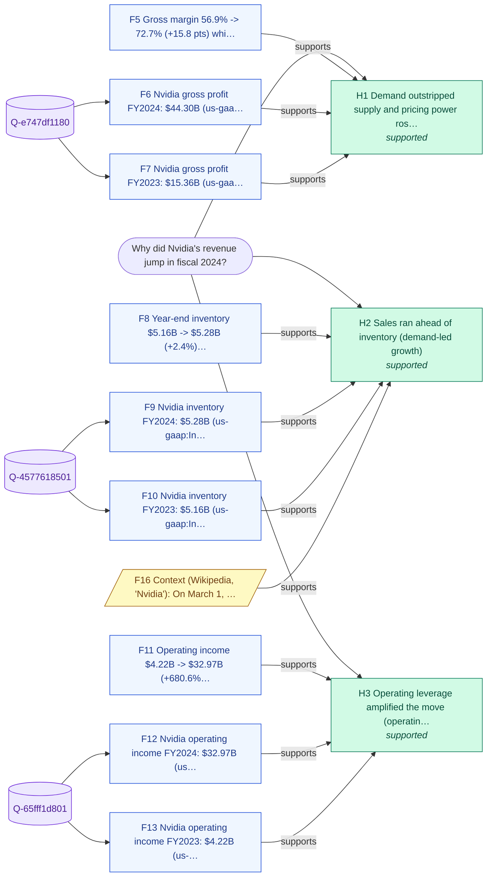

# Why did Nvidia's revenue jump in fiscal 2024?

_Backend: **duckdb** · LLM: none · started 2026-10-22T10:48:01Z_

## Answer

Nvidia's revenue rose in FY2024: $26.97B -> $60.92B (+125.9%). The evidence points mainly to (1) demand outstripped supply and pricing power rose (gross margin expanded with revenue); (2) sales ran ahead of inventory (demand-led growth); (3) operating leverage amplified the move (operating income moved more than revenue).

**Confidence: High (0.7)** - 3 of 3 hypotheses supported; supported drivers cover ~100% of the move; 88% of queries returned data; 1 context corroborations.

## Because

- **Demand outstripped supply and pricing power rose (gross margin expanded with revenue)** - Margin moved with revenue - consistent with pricing power / mix. [F5, F6, F7]
- **Sales ran ahead of inventory (demand-led growth)** -  [F8, F9, F10, F16]
- **Operating leverage amplified the move (operating income moved more than revenue)** -  [F11, F12, F13]

## Caveats

- Values are the latest filed (as-restated) figures per period; XBRL tags vary by company and year.
- SEC companyfacts has no segment breakdown, so which products or customers drove revenue is not established here; confidence is capped at 0.70.
- Context snippets from Wikipedia corroborate hypotheses but never supply numbers.

## Hypotheses tested

| # | Hypothesis | Test | Verdict | Detail |
|---|---|---|---|---|
| H1 | Demand outstripped supply and pricing power rose (gross margin expanded with revenue) | Gross margin change alongside revenue (>= 2 pts) | **supported** | Margin moved with revenue - consistent with pricing power / mix. |
| H2 | Sales ran ahead of inventory (demand-led growth) | Inventory growth vs revenue growth (10-pt gap) | **supported** |  |
| H3 | Operating leverage amplified the move (operating income moved more than revenue) | Operating income % change vs revenue % change | **supported** |  |

## Evidence (every claim's source)

| # | Finding | Kind | Query · rows | Source |
|---|---|---|---|---|
| F1 | Nvidia revenue FY2023: $26.97B (us-gaap:Revenues, 10-K filed 2025-02-26, period ending 2023-01-29) | data | `Q-42a2962524` · [99] | [link](https://data.sec.gov/api/xbrl/companyconcept/CIK0001045810/us-gaap/Revenues.json) |
| F2 | Nvidia revenue FY2024: $60.92B (us-gaap:Revenues, 10-K filed 2026-02-25, period ending 2024-01-28) | data | `Q-42a2962524` · [102] | [link](https://data.sec.gov/api/xbrl/companyconcept/CIK0001045810/us-gaap/Revenues.json) |
| F3 | Nvidia revenue FY2023 -> FY2024: $26.97B -> $60.92B (+125.9%) | derived | `Q-42a2962524` · [102] |  |
| F4 | Revenue trend: FY2021: $16.68B, FY2022: $26.91B, FY2023: $26.97B, FY2024: $60.92B | derived |  |  |
| F5 | Gross margin 56.9% -> 72.7% (+15.8 pts) while revenue moved +125.9% | derived |  |  |
| F6 | Nvidia gross profit FY2024: $44.30B (us-gaap:GrossProfit, 10-K filed 2026-02-25, period ending 2024-01-28) | data | `Q-e747df1180` · [127] | [link](https://data.sec.gov/api/xbrl/companyconcept/CIK0001045810/us-gaap/GrossProfit.json) |
| F7 | Nvidia gross profit FY2023: $15.36B (us-gaap:GrossProfit, 10-K filed 2025-02-26, period ending 2023-01-29) | data | `Q-e747df1180` · [124] | [link](https://data.sec.gov/api/xbrl/companyconcept/CIK0001045810/us-gaap/GrossProfit.json) |
| F8 | Year-end inventory $5.16B -> $5.28B (+2.4%) vs revenue +125.9% | derived |  |  |
| F9 | Nvidia inventory FY2024: $5.28B (us-gaap:InventoryNet, 10-K filed 2025-02-26, period ending 2024-01-28) | data | `Q-4577618501` · [30] | [link](https://data.sec.gov/api/xbrl/companyconcept/CIK0001045810/us-gaap/InventoryNet.json) |
| F10 | Nvidia inventory FY2023: $5.16B (us-gaap:InventoryNet, 10-K filed 2024-02-21, period ending 2023-01-29) | data | `Q-4577618501` · [28] | [link](https://data.sec.gov/api/xbrl/companyconcept/CIK0001045810/us-gaap/InventoryNet.json) |
| F11 | Operating income $4.22B -> $32.97B (+680.6%) vs revenue +125.9% | derived |  |  |
| F12 | Nvidia operating income FY2024: $32.97B (us-gaap:OperatingIncomeLoss, 10-K filed 2026-02-25, period ending 2024-01-28) | data | `Q-65fff1d801` · [47] | [link](https://data.sec.gov/api/xbrl/companyconcept/CIK0001045810/us-gaap/OperatingIncomeLoss.json) |
| F13 | Nvidia operating income FY2023: $4.22B (us-gaap:OperatingIncomeLoss, 10-K filed 2025-02-26, period ending 2023-01-29) | data | `Q-65fff1d801` · [44] | [link](https://data.sec.gov/api/xbrl/companyconcept/CIK0001045810/us-gaap/OperatingIncomeLoss.json) |
| F14 | R&D grew +87.0% from FY2021 to FY2023 ($3.92B -> $7.34B), the investment base behind FY2024 products | derived |  |  |
| F15 | Context (Wikipedia, 'Nvidia'): In February 2024, it was reported that Nvidia was the "hot employer" in Silicon Valley because it was offering interesting work and good pay at a time when other tech employers were downsizing. | context |  | [link](https://en.wikipedia.org/wiki/Nvidia) |
| F16 | Context (Wikipedia, 'Nvidia'): On March 1, 2024, Nvidia became the third company in the history of the United States to close with a market capitalization in excess of $2 trillion. | context |  | [link](https://en.wikipedia.org/wiki/Nvidia) |
| F17 | Context (Wikipedia, 'Nvidia'): On June 18, 2024, the company became the world's most valuable, surpassing Microsoft and Apple, after its market capitalization exceeded $3.3 trillion. | context |  | [link](https://en.wikipedia.org/wiki/Nvidia) |
| F18 | Context (Wikipedia, 'Nvidia'): In November 2024, the company was added to the Dow Jones Industrial Average. | context |  | [link](https://en.wikipedia.org/wiki/Nvidia) |

## Queries run through the data harness

- `Q-cc22c909d8` (duckdb, 3 rows) - capital expenditure (PaymentsToAcquirePropertyPlantAndEquipment) annual 10-K facts
  ```sql
  SELECT period_start, period_end, value_usd, form_type, fiscal_period, filed_date, accession_number FROM edgar_concept_0001045810_paymentstoacquirepropertyplantandequipment WHERE form_type = '10-K' AND fiscal_period = 'FY' ORDER BY period_end, filed_date
  ```
  source: `edgar_concept_0001045810_paymentstoacquirepropertyplantandequipment` <- https://data.sec.gov/api/xbrl/companyconcept/CIK0001045810/us-gaap/PaymentsToAcquirePropertyPlantAndEquipment.json
- `Q-5dde945143` (duckdb, 9 rows) - capital expenditure (PaymentsToAcquireProductiveAssets) annual 10-K facts
  ```sql
  SELECT period_start, period_end, value_usd, form_type, fiscal_period, filed_date, accession_number FROM edgar_concept_0001045810_paymentstoacquireproductiveassets WHERE form_type = '10-K' AND fiscal_period = 'FY' ORDER BY period_end, filed_date
  ```
  source: `edgar_concept_0001045810_paymentstoacquireproductiveassets` <- https://data.sec.gov/api/xbrl/companyconcept/CIK0001045810/us-gaap/PaymentsToAcquireProductiveAssets.json
- `Q-a0b9150e4d` (duckdb, 0 rows) - restructuring and impairment charges (RestructuringSettlementAndImpairmentProvisions) annual 10-K facts
  ```sql
  SELECT period_start, period_end, value_usd, form_type, fiscal_period, filed_date, accession_number FROM edgar_concept_0001045810_restructuringsettlementandimpairmentprovisions WHERE form_type = '10-K' AND fiscal_period = 'FY' ORDER BY period_end, filed_date
  ```
  source: `edgar_concept_0001045810_restructuringsettlementandimpairmentprovisions` <- https://data.sec.gov/api/xbrl/companyconcept/CIK0001045810/us-gaap/RestructuringSettlementAndImpairmentProvisions.json
- `Q-1eb3bea1bc` (duckdb, 12 rows) - restructuring and impairment charges (RestructuringCharges) annual 10-K facts
  ```sql
  SELECT period_start, period_end, value_usd, form_type, fiscal_period, filed_date, accession_number FROM edgar_concept_0001045810_restructuringcharges WHERE form_type = '10-K' AND fiscal_period = 'FY' ORDER BY period_end, filed_date
  ```
  source: `edgar_concept_0001045810_restructuringcharges` <- https://data.sec.gov/api/xbrl/companyconcept/CIK0001045810/us-gaap/RestructuringCharges.json
- `Q-8544f73b23` (duckdb, 0 rows) - restructuring and impairment charges (AssetImpairmentCharges) annual 10-K facts
  ```sql
  SELECT period_start, period_end, value_usd, form_type, fiscal_period, filed_date, accession_number FROM edgar_concept_0001045810_assetimpairmentcharges WHERE form_type = '10-K' AND fiscal_period = 'FY' ORDER BY period_end, filed_date
  ```
  source: `edgar_concept_0001045810_assetimpairmentcharges` <- https://data.sec.gov/api/xbrl/companyconcept/CIK0001045810/us-gaap/AssetImpairmentCharges.json
- `Q-66c2863c7f` (duckdb, 106 rows) - cost of sales (CostOfRevenue) annual 10-K facts
  ```sql
  SELECT period_start, period_end, value_usd, form_type, fiscal_period, filed_date, accession_number FROM edgar_concept_0001045810_costofrevenue WHERE form_type = '10-K' AND fiscal_period = 'FY' ORDER BY period_end, filed_date
  ```
  source: `edgar_concept_0001045810_costofrevenue` <- https://data.sec.gov/api/xbrl/companyconcept/CIK0001045810/us-gaap/CostOfRevenue.json
- `Q-96822e6e7c` (duckdb, 48 rows) - depreciation (Depreciation) annual 10-K facts
  ```sql
  SELECT period_start, period_end, value_usd, form_type, fiscal_period, filed_date, accession_number FROM edgar_concept_0001045810_depreciation WHERE form_type = '10-K' AND fiscal_period = 'FY' ORDER BY period_end, filed_date
  ```
  source: `edgar_concept_0001045810_depreciation` <- https://data.sec.gov/api/xbrl/companyconcept/CIK0001045810/us-gaap/Depreciation.json
- `Q-39831085f7` (duckdb, 23 rows) - goodwill impairment (GoodwillImpairmentLoss) annual 10-K facts
  ```sql
  SELECT period_start, period_end, value_usd, form_type, fiscal_period, filed_date, accession_number FROM edgar_concept_0001045810_goodwillimpairmentloss WHERE form_type = '10-K' AND fiscal_period = 'FY' ORDER BY period_end, filed_date
  ```
  source: `edgar_concept_0001045810_goodwillimpairmentloss` <- https://data.sec.gov/api/xbrl/companyconcept/CIK0001045810/us-gaap/GoodwillImpairmentLoss.json
- `Q-e747df1180` (duckdb, 131 rows) - gross profit (GrossProfit) annual 10-K facts
  ```sql
  SELECT period_start, period_end, value_usd, form_type, fiscal_period, filed_date, accession_number FROM edgar_concept_0001045810_grossprofit WHERE form_type = '10-K' AND fiscal_period = 'FY' ORDER BY period_end, filed_date
  ```
  source: `edgar_concept_0001045810_grossprofit` <- https://data.sec.gov/api/xbrl/companyconcept/CIK0001045810/us-gaap/GrossProfit.json
- `Q-4577618501` (duckdb, 34 rows) - inventory (InventoryNet) annual 10-K facts
  ```sql
  SELECT period_start, period_end, value_usd, form_type, fiscal_period, filed_date, accession_number FROM edgar_concept_0001045810_inventorynet WHERE form_type = '10-K' AND fiscal_period = 'FY' ORDER BY period_end, filed_date
  ```
  source: `edgar_concept_0001045810_inventorynet` <- https://data.sec.gov/api/xbrl/companyconcept/CIK0001045810/us-gaap/InventoryNet.json
- `Q-2bbf56a1e4` (duckdb, 8 rows) - inventory write-downs (InventoryWriteDown) annual 10-K facts
  ```sql
  SELECT period_start, period_end, value_usd, form_type, fiscal_period, filed_date, accession_number FROM edgar_concept_0001045810_inventorywritedown WHERE form_type = '10-K' AND fiscal_period = 'FY' ORDER BY period_end, filed_date
  ```
  source: `edgar_concept_0001045810_inventorywritedown` <- https://data.sec.gov/api/xbrl/companyconcept/CIK0001045810/us-gaap/InventoryWriteDown.json
- `Q-69e531a134` (duckdb, 132 rows) - net income (NetIncomeLoss) annual 10-K facts
  ```sql
  SELECT period_start, period_end, value_usd, form_type, fiscal_period, filed_date, accession_number FROM edgar_concept_0001045810_netincomeloss WHERE form_type = '10-K' AND fiscal_period = 'FY' ORDER BY period_end, filed_date
  ```
  source: `edgar_concept_0001045810_netincomeloss` <- https://data.sec.gov/api/xbrl/companyconcept/CIK0001045810/us-gaap/NetIncomeLoss.json
- `Q-65fff1d801` (duckdb, 51 rows) - operating income (OperatingIncomeLoss) annual 10-K facts
  ```sql
  SELECT period_start, period_end, value_usd, form_type, fiscal_period, filed_date, accession_number FROM edgar_concept_0001045810_operatingincomeloss WHERE form_type = '10-K' AND fiscal_period = 'FY' ORDER BY period_end, filed_date
  ```
  source: `edgar_concept_0001045810_operatingincomeloss` <- https://data.sec.gov/api/xbrl/companyconcept/CIK0001045810/us-gaap/OperatingIncomeLoss.json
- `Q-e70997a12b` (duckdb, 51 rows) - R&D expense (ResearchAndDevelopmentExpense) annual 10-K facts
  ```sql
  SELECT period_start, period_end, value_usd, form_type, fiscal_period, filed_date, accession_number FROM edgar_concept_0001045810_researchanddevelopmentexpense WHERE form_type = '10-K' AND fiscal_period = 'FY' ORDER BY period_end, filed_date
  ```
  source: `edgar_concept_0001045810_researchanddevelopmentexpense` <- https://data.sec.gov/api/xbrl/companyconcept/CIK0001045810/us-gaap/ResearchAndDevelopmentExpense.json
- `Q-42a2962524` (duckdb, 106 rows) - revenue (Revenues) annual 10-K facts
  ```sql
  SELECT period_start, period_end, value_usd, form_type, fiscal_period, filed_date, accession_number FROM edgar_concept_0001045810_revenues WHERE form_type = '10-K' AND fiscal_period = 'FY' ORDER BY period_end, filed_date
  ```
  source: `edgar_concept_0001045810_revenues` <- https://data.sec.gov/api/xbrl/companyconcept/CIK0001045810/us-gaap/Revenues.json
- `Q-cc192e57b6` (duckdb, 51 rows) - SG&A expense (SellingGeneralAndAdministrativeExpense) annual 10-K facts
  ```sql
  SELECT period_start, period_end, value_usd, form_type, fiscal_period, filed_date, accession_number FROM edgar_concept_0001045810_sellinggeneralandadministrativeexpense WHERE form_type = '10-K' AND fiscal_period = 'FY' ORDER BY period_end, filed_date
  ```
  source: `edgar_concept_0001045810_sellinggeneralandadministrativeexpense` <- https://data.sec.gov/api/xbrl/companyconcept/CIK0001045810/us-gaap/SellingGeneralAndAdministrativeExpense.json

## Evidence graph



## Reasoning trace

1. **scout** - Intent explain.company_metric (band high, risk low); signed contract 001A1633999DD0000DF268187CA
1. **recall** - H-MEM recalled 1 prior beliefs (minimal)
1. **plan** - Resolve NVIDIA CORP (CIK 0001045810) and pull revenue for FY2021-FY2024 from SEC EDGAR
1. **queries** - Ran 16 harness queries over 13 XBRL concepts
1. **findings** - Target moved $26.97B -> $60.92B (+125.9%)
1. **hypotheses** - Revenue: test pricing power, demand vs supply signals and operating leverage
1. **context** - Background search found 4 context snippets (context corroborates, never supplies numbers)
1. **remember** - Wrote 10 memories with provenance; 0 conflicts with prior beliefs
1. **done** - Finished in 6.6s

## Scout execution contract

Intent `explain.company_metric` (band high, risk low). Contract `001A1633999DD0000DF268187CA`, capabilities ['background.search', 'harness.query', 'llm.narrate', 'memory.recall', 'memory.write'], expires 2026-10-22T10:53:01Z, HMAC `408da924d9320580…`.

## Recalled from memory (H-MEM)

- Intel revenue FY2024: $53.10B (us-gaap:RevenueFromContractWithCustomerExcludingAssessedTax, 10-K filed 2026-01-23, period ending 2024-12-28) (score 0.3777, F4 of 'Why did Intel's gross margin fall in 2024?')

_Wrote 10 memories with provenance; 0 conflicts with prior beliefs._
