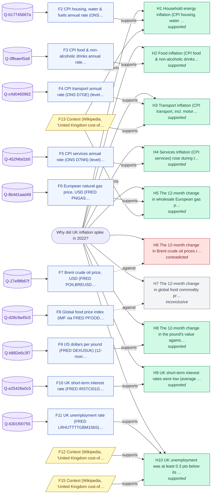

# Why did UK inflation spike in 2022?

_Backend: **zetaris-jdbc** · LLM: none · started 2026-10-23T12:02:29Z_

## Answer

UK inflation rose in 2022: 5.4% (2021-12) -> 11.1% (2022-10 peak), +5.7 pts; 2020 average 0.8%. The evidence is consistent with these drivers: (1) household energy inflation (CPI housing, water & fuels) rose during the run-up to the 2022 peak; (2) food inflation (CPI food & non-alcoholic drinks) rose during the run-up to the 2022 peak; (3) the 12-month change in the pound's value against the dollar fell during the run-up to the 2022 peak.

**Confidence: High (0.85)** - 8 of 10 hypotheses supported across 6 independent cause group(s); supported drivers carry ~100% of the tested evidence weight (de-duplicated by cause; this is not a share of the move); 100% of queries returned data; 5 context corroborations; 1 hypotheses contradicted; macro answers are capped at 0.85 (no CPI weights applied).

## Because

- **Household energy inflation (CPI housing, water & fuels) rose during the run-up to the 2022 peak** - Changed +19.7 pts over the same interval, the direction needed, and co-moved with the target (r=+0.98). Co-movement, not proof of cause. Context (not tested): Household gas and electricity bills follow wholesale prices with a lag (in the UK via the Ofgem price cap). [F2, F13]
- **Food inflation (CPI food & non-alcoholic drinks) rose during the run-up to the 2022 peak** - Changed +12.0 pts over the same interval, the direction needed, and co-moved with the target (r=+0.93). Co-movement, not proof of cause. Context (not tested): Retail food prices pass through farm, fertiliser and energy costs over several months. [F3]
- **The 12-month change in wholesale European gas prices rose during the run-up to the 2022 peak** - Changed +159.5 pts over the same interval (its best lead, 9 months earlier), the direction needed, and co-moved with the target (r=+0.92). Co-movement, not proof of cause. Context (not tested): the 2021-22 European gas crisis and Russia's invasion of Ukraine (Feb 2022) drove wholesale gas to record highs; prices fell back through 2023. [F6, F13]
- **The 12-month change in the pound's value against the dollar fell during the run-up to the 2022 peak** - Changed -16.3 pts over the same interval, the direction needed, and co-moved with the target (r=-0.64). Co-movement, not proof of cause. Context (not tested): A weaker pound raises the sterling cost of dollar-priced imports such as energy and food. [F9]
- **Services inflation (CPI services) rose during the run-up to the 2022 peak** - Changed +2.9 pts over the same interval, the direction needed, and co-moved with the target (r=+0.97). Co-movement, not proof of cause. Context (not tested): Services prices are labour-intensive, so they tend to reflect wage growth. [F5]
- **Transport inflation (CPI transport, incl. motor fuel) rose during the run-up to the 2022 peak** - Changed +2.1 pts over the same interval (its best lead, 2 months earlier), the direction needed, and co-moved with the target (r=+0.94). Co-movement, not proof of cause. Context (not tested): Motor fuel prices track crude oil quickly. [F4, F13]
- **UK short-term interest rates were low (average below 1%) in the 6-18 months before the 2022 peak** - Pre-peak conditions match (an enabling condition, not a trigger). Context (not tested): Low rates are an enabling condition for demand, not a trigger. [F10]
- **UK unemployment was at least 0.3 pts below its 2020 average in the 6-18 months before the 2022 peak** - Pre-peak conditions match (an enabling condition, not a trigger). Context (not tested): A tight labour market tends to push wages, and then services prices, up. [F11, F12, F15]

## Counter-evidence and limits

- Correlation is not causation: each supported driver moved the needed way over the same interval and co-moved with the target, which is consistent with it contributing but does not prove it did; component weights are not applied. [F1]
- Not supported: The 12-month change in Brent crude oil prices rose during the run-up to the 2022 peak. Changed -40.0 pts over the same interval (its best lead, 7 months earlier): the opposite direction. [F7]
- Weak or no support: The 12-month change in global food commodity prices rose during the run-up to the 2022 peak. Change of -4.7 pts is below the materiality threshold (5 pts). [F8]

## Caveats

- The move is measured from December of the prior year to the in-year extreme; drivers are tested over the same interval.
- Correlation over a short window is evidence of co-movement, not proof of causation; component weights are not applied.
- Context notes are background mechanisms; they are not tested and never supply numbers.
- Context snippets from Wikipedia corroborate hypotheses but never supply numbers.

## Hypotheses tested

| # | Hypothesis | Test | Verdict | Detail |
|---|---|---|---|---|
| H1 | Household energy inflation (CPI housing, water & fuels) rose during the run-up to the 2022 peak | CPI housing, water & fuels annual rate (ONS D7GB): sign and size of its change over the target's 2021-12 -> 2022-10 interval (shifted by its best lead of 0-9 months), and lead correlation r >= 0.5 | **supported** | Changed +19.7 pts over the same interval, the direction needed, and co-moved with the target (r=+0.98). Co-movement, not proof of cause. |
| H2 | Food inflation (CPI food & non-alcoholic drinks) rose during the run-up to the 2022 peak | CPI food & non-alcoholic drinks annual rate (ONS D7G8): sign and size of its change over the target's 2021-12 -> 2022-10 interval (shifted by its best lead of 0-9 months), and lead correlation r >= 0.5 | **supported** | Changed +12.0 pts over the same interval, the direction needed, and co-moved with the target (r=+0.93). Co-movement, not proof of cause. |
| H3 | Transport inflation (CPI transport, incl. motor fuel) rose during the run-up to the 2022 peak | CPI transport annual rate (ONS D7GE): sign and size of its change over the target's 2021-12 -> 2022-10 interval (shifted by its best lead of 0-9 months), and lead correlation r >= 0.5 | **supported** | Changed +2.1 pts over the same interval (its best lead, 2 months earlier), the direction needed, and co-moved with the target (r=+0.94). Co-movement, not proof of cause. |
| H4 | Services inflation (CPI services) rose during the run-up to the 2022 peak | CPI services annual rate (ONS D7NN): sign and size of its change over the target's 2021-12 -> 2022-10 interval (shifted by its best lead of 0-9 months), and lead correlation r >= 0.5 | **supported** | Changed +2.9 pts over the same interval, the direction needed, and co-moved with the target (r=+0.97). Co-movement, not proof of cause. |
| H5 | The 12-month change in wholesale European gas prices rose during the run-up to the 2022 peak | European natural gas price, USD (FRED PNGASEUUSDM): sign and size of its change over the target's 2021-12 -> 2022-10 interval (shifted by its best lead of 0-9 months), and lead correlation r >= 0.5 | **supported** | Changed +159.5 pts over the same interval (its best lead, 9 months earlier), the direction needed, and co-moved with the target (r=+0.92). Co-movement, not proof of cause. |
| H6 | The 12-month change in Brent crude oil prices rose during the run-up to the 2022 peak | Brent crude oil price, USD (FRED POILBREUSDM): sign and size of its change over the target's 2021-12 -> 2022-10 interval (shifted by its best lead of 0-9 months), and lead correlation r >= 0.5 | **contradicted** | Changed -40.0 pts over the same interval (its best lead, 7 months earlier): the opposite direction. |
| H7 | The 12-month change in global food commodity prices rose during the run-up to the 2022 peak | Global food price index (IMF via FRED PFOODINDEXM): sign and size of its change over the target's 2021-12 -> 2022-10 interval (shifted by its best lead of 0-9 months), and lead correlation r >= 0.5 | **inconclusive** | Change of -4.7 pts is below the materiality threshold (5 pts). |
| H8 | The 12-month change in the pound's value against the dollar fell during the run-up to the 2022 peak | US dollars per pound (FRED DEXUSUK): sign and size of its change over the target's 2021-12 -> 2022-10 interval (shifted by its best lead of 0-9 months), and lead correlation r >= 0.5 | **supported** | Changed -16.3 pts over the same interval, the direction needed, and co-moved with the target (r=-0.64). Co-movement, not proof of cause. |
| H9 | UK short-term interest rates were low (average below 1%) in the 6-18 months before the 2022 peak | UK short-term interest rate (FRED IRSTCI01GBM156N): level in the 6-18 months before the peak | **supported** | Pre-peak conditions match (an enabling condition, not a trigger). |
| H10 | UK unemployment was at least 0.3 pts below its 2020 average in the 6-18 months before the 2022 peak | UK unemployment rate (FRED LRHUTTTTGBM156S): level in the 6-18 months before the peak | **supported** | Pre-peak conditions match (an enabling condition, not a trigger). |

## Evidence (every claim's source)

| # | Finding | Kind | Query · rows | Source |
|---|---|---|---|---|
| F1 | UK CPI annual rate (ONS D7G7): 5.4% in 2021-12 (start of 2022) -> 11.1% in 2022-10 (the 2022 peak), +5.7 pts; for context, the 2020 average was 0.8% | data | `Q-adbf08cc42` · [47, 57] | [link](https://www.ons.gov.uk/economy/inflationandpriceindices/timeseries/d7g7/mm23/data) |
| F2 | CPI housing, water & fuels annual rate (ONS D7GB) (level): 6.9% in 2021-12 -> 26.6% in 2022-10, a change of +19.7 pts; correlation with the target r=+0.98 at a 0-month lead | data | `Q-b17745667a` · [45, 47, 57] | [link](https://www.ons.gov.uk/economy/inflationandpriceindices/timeseries/d7gb/mm23/data) |
| F3 | CPI food & non-alcoholic drinks annual rate (ONS D7G8) (level): 4.2% in 2021-12 -> 16.2% in 2022-10, a change of +12.0 pts; correlation with the target r=+0.93 at a 0-month lead | data | `Q-3ffeae45a9` · [45, 47, 57] | [link](https://www.ons.gov.uk/economy/inflationandpriceindices/timeseries/d7g8/mm23/data) |
| F4 | CPI transport annual rate (ONS D7GE) (level): 9.9% in 2021-10 -> 12.0% in 2022-08 (its best lead, 2 months earlier), a change of +2.1 pts; correlation with the target r=+0.94 at a 2-month lead | data | `Q-c4d0460962` · [43, 45, 55] | [link](https://www.ons.gov.uk/economy/inflationandpriceindices/timeseries/d7ge/mm23/data) |
| F5 | CPI services annual rate (ONS D7NN) (level): 3.4% in 2021-12 -> 6.3% in 2022-10, a change of +2.9 pts; correlation with the target r=+0.97 at a 0-month lead | data | `Q-452f4bd1b0` · [45, 47, 57] | [link](https://www.ons.gov.uk/economy/inflationandpriceindices/timeseries/d7nn/mm23/data) |
| F6 | European natural gas price, USD (FRED PNGASEUUSDM) (12-month % change): 122.4% in 2021-03 -> 281.9% in 2022-01 (its best lead, 9 months earlier), a change of +159.5 pts; correlation with the target r=+0.92 at a 9-month lead | derived | `Q-8b4d1aad49` · [36, 38, 48] | [link](https://fred.stlouisfed.org/graph/fredgraph.csv?id=PNGASEUUSDM) |
| F7 | Brent crude oil price, USD (FRED POILBREUSDM) (12-month % change): 110.9% in 2021-05 -> 70.9% in 2022-03 (its best lead, 7 months earlier), a change of -40.0 pts; correlation with the target r=+0.77 at a 7-month lead | derived | `Q-27ef8fb67f` · [38, 40, 50] | [link](https://fred.stlouisfed.org/graph/fredgraph.csv?id=POILBREUSDM) |
| F8 | Global food price index (IMF via FRED PFOODINDEXM) (12-month % change): 26.0% in 2021-03 -> 21.3% in 2022-01 (its best lead, 9 months earlier), a change of -4.7 pts; correlation with the target r=+0.82 at a 9-month lead | derived | `Q-d28c9a45c5` · [36, 38, 48] | [link](https://fred.stlouisfed.org/graph/fredgraph.csv?id=PFOODINDEXM) |
| F9 | US dollars per pound (FRED DEXUSUK) (12-month % change): -1.0% in 2021-12 -> -17.3% in 2022-10, a change of -16.3 pts; correlation with the target r=-0.64 at a 0-month lead | derived | `Q-b882e6c3f7` · [936, 976, 1186] | [link](https://fred.stlouisfed.org/graph/fredgraph.csv?id=DEXUSUK) |
| F10 | UK short-term interest rate (FRED IRSTCI01GBM156N): averaged 0.18 in the 6-18 months before the 2022-10 peak (vs 0.19 in 2020); 2.19 at 2022-10 | data | `Q-e25426e0c5` · [57] | [link](https://fred.stlouisfed.org/graph/fredgraph.csv?id=IRSTCI01GBM156N) |
| F11 | UK unemployment rate (FRED LRHUTTTTGBM156S): averaged 4.23 in the 6-18 months before the 2022-10 peak (vs 4.60 in 2020); 3.90 at 2022-10 | data | `Q-6301f00755` · [57] | [link](https://fred.stlouisfed.org/graph/fredgraph.csv?id=LRHUTTTTGBM156S) |
| F12 | Context (Wikipedia, 'United Kingdom cost-of-living crisis'): By January 2024, the 12-month Retail Price Index had fallen to 4% after peaking at 11.1% in October 2022, while workers' wages had risen 6.2% in the last quarter of 2023. | context |  | [link](https://en.wikipedia.org/wiki/United_Kingdom_cost-of-living_crisis) |
| F13 | Context (Wikipedia, 'United Kingdom cost-of-living crisis'): Factors that have worsened the crisis since 1 April 2022 include Ofgem increasing the household energy price cap by 54%, an increase in National Insurance and a rise in Council Tax. | context |  | [link](https://en.wikipedia.org/wiki/United_Kingdom_cost-of-living_crisis) |
| F14 | Context (Wikipedia, 'United Kingdom cost-of-living crisis'): In 2022, household income – whether from earnings or benefits – had not generally kept pace with rising prices. | context |  | [link](https://en.wikipedia.org/wiki/United_Kingdom_cost-of-living_crisis) |
| F15 | Context (Wikipedia, 'United Kingdom cost-of-living crisis'): In April 2022, UK real wages fell by 4.5%, the sharpest fall since records began back in 2001. | context |  | [link](https://en.wikipedia.org/wiki/United_Kingdom_cost-of-living_crisis) |
| F16 | Cross-source (ONS x FRED, one federated SQL JOIN on month): over 2015-01 to 2022-12, UK CPI annual rate tracks the 12-month change in European natural gas price (USD) 9 months earlier most closely (r = 0.90, n = 96 months, strong); same-month r = 0.45 | cross-source | `Q-49752693a1` · [0, 3] | [link](https://fred.stlouisfed.org/graph/fredgraph.csv?id=PNGASEUUSDM) |

## Queries run through the data harness

- `Q-adbf08cc42` (zetaris-jdbc, 72 rows) - UK CPI annual rate (ONS D7G7)
  ```sql
  SELECT period, value FROM because.ons_series_d7g7 WHERE period >= '2018-01' AND period <= '2023-12-31' ORDER BY period
  ```
  source: `because.ons_series_d7g7` <- https://www.ons.gov.uk/economy/inflationandpriceindices/timeseries/d7g7/mm23/data
- `Q-b17745667a` (zetaris-jdbc, 72 rows) - CPI housing, water & fuels annual rate (ONS D7GB)
  ```sql
  SELECT period, value FROM because.ons_series_d7gb WHERE period >= '2018-01' AND period <= '2023-12-31' ORDER BY period
  ```
  source: `because.ons_series_d7gb` <- https://www.ons.gov.uk/economy/inflationandpriceindices/timeseries/d7gb/mm23/data
- `Q-3ffeae45a9` (zetaris-jdbc, 72 rows) - CPI food & non-alcoholic drinks annual rate (ONS D7G8)
  ```sql
  SELECT period, value FROM because.ons_series_d7g8 WHERE period >= '2018-01' AND period <= '2023-12-31' ORDER BY period
  ```
  source: `because.ons_series_d7g8` <- https://www.ons.gov.uk/economy/inflationandpriceindices/timeseries/d7g8/mm23/data
- `Q-c4d0460962` (zetaris-jdbc, 72 rows) - CPI transport annual rate (ONS D7GE)
  ```sql
  SELECT period, value FROM because.ons_series_d7ge WHERE period >= '2018-01' AND period <= '2023-12-31' ORDER BY period
  ```
  source: `because.ons_series_d7ge` <- https://www.ons.gov.uk/economy/inflationandpriceindices/timeseries/d7ge/mm23/data
- `Q-452f4bd1b0` (zetaris-jdbc, 72 rows) - CPI services annual rate (ONS D7NN)
  ```sql
  SELECT period, value FROM because.ons_series_d7nn WHERE period >= '2018-01' AND period <= '2023-12-31' ORDER BY period
  ```
  source: `because.ons_series_d7nn` <- https://www.ons.gov.uk/economy/inflationandpriceindices/timeseries/d7nn/mm23/data
- `Q-8b4d1aad49` (zetaris-jdbc, 72 rows) - European natural gas price, USD (FRED PNGASEUUSDM)
  ```sql
  SELECT period, value FROM because.fred_series_pngaseuusdm WHERE period >= '2018-01' AND period <= '2023-12-31' ORDER BY period
  ```
  source: `because.fred_series_pngaseuusdm` <- https://fred.stlouisfed.org/graph/fredgraph.csv?id=PNGASEUUSDM
- `Q-27ef8fb67f` (zetaris-jdbc, 72 rows) - Brent crude oil price, USD (FRED POILBREUSDM)
  ```sql
  SELECT period, value FROM because.fred_series_poilbreusdm WHERE period >= '2018-01' AND period <= '2023-12-31' ORDER BY period
  ```
  source: `because.fred_series_poilbreusdm` <- https://fred.stlouisfed.org/graph/fredgraph.csv?id=POILBREUSDM
- `Q-d28c9a45c5` (zetaris-jdbc, 72 rows) - Global food price index (IMF via FRED PFOODINDEXM)
  ```sql
  SELECT period, value FROM because.fred_series_pfoodindexm WHERE period >= '2018-01' AND period <= '2023-12-31' ORDER BY period
  ```
  source: `because.fred_series_pfoodindexm` <- https://fred.stlouisfed.org/graph/fredgraph.csv?id=PFOODINDEXM
- `Q-b882e6c3f7` (zetaris-jdbc, 1496 rows) - US dollars per pound (FRED DEXUSUK)
  ```sql
  SELECT period, value FROM because.fred_series_dexusuk WHERE period >= '2018-01' AND period <= '2023-12-31' ORDER BY period
  ```
  source: `because.fred_series_dexusuk` <- https://fred.stlouisfed.org/graph/fredgraph.csv?id=DEXUSUK
- `Q-e25426e0c5` (zetaris-jdbc, 72 rows) - UK short-term interest rate (FRED IRSTCI01GBM156N)
  ```sql
  SELECT period, value FROM because.fred_series_irstci01gbm156n WHERE period >= '2018-01' AND period <= '2023-12-31' ORDER BY period
  ```
  source: `because.fred_series_irstci01gbm156n` <- https://fred.stlouisfed.org/graph/fredgraph.csv?id=IRSTCI01GBM156N
- `Q-6301f00755` (zetaris-jdbc, 72 rows) - UK unemployment rate (FRED LRHUTTTTGBM156S)
  ```sql
  SELECT period, value FROM because.fred_series_lrhuttttgbm156s WHERE period >= '2018-01' AND period <= '2023-12-31' ORDER BY period
  ```
  source: `because.fred_series_lrhuttttgbm156s` <- https://fred.stlouisfed.org/graph/fredgraph.csv?id=LRHUTTTTGBM156S
- `Q-49752693a1` (zetaris-jdbc, 5 rows) - cross-source: ONS D7G7 JOIN FRED PNGASEUUSDM on month, driver leading 0-12 months
  ```sql
  SELECT l.lag_m, ROUND(CORR(x.v, y.v), 3) AS r, COUNT(*) AS n FROM (SELECT period, value AS v FROM because.ons_series_d7g7) x CROSS JOIN (SELECT 0 AS lag_m UNION ALL SELECT 3 AS lag_m UNION ALL SELECT 6 AS lag_m UNION ALL SELECT 9 AS lag_m UNION ALL SELECT 12 AS lag_m) l JOIN (SELECT s.period, (s.value / s.v12 - 1) * 100 AS v FROM (SELECT period, value, LAG(value, 12) OVER (ORDER BY period) AS v12, LAG(period, 12) OVER (ORDER BY period) AS p12 FROM because.fred_series_pngaseuusdm) s WHERE s.v12 IS NOT NULL AND s.v12 <> 0 AND (CAST(SUBSTR(s.period, 1, 4) AS INT) * 12 + CAST(SUBSTR(s.period, 6, 2) AS INT)) - (CAST(SUBSTR(s.p12, 1, 4) AS INT) * 12 + CAST(SUBSTR(s.p12, 6, 2) AS INT)) = 12) y ON (CAST(SUBSTR(y.period, 1, 4) AS INT) * 12 + CAST(SUBSTR(y.period, 6, 2) AS INT)) + l.lag_m = (CAST(SUBSTR(x.period, 1, 4) AS INT) * 12 + CAST(SUBSTR(x.period, 6, 2) AS INT)) WHERE SUBSTR(x.period, 1, 7) >= '2015-01' AND SUBSTR(x.period, 1, 7) <= '2022-12' GROUP BY l.lag_m ORDER BY l.lag_m
  ```
  source: `because.ons_series_d7g7` <- https://www.ons.gov.uk/economy/inflationandpriceindices/timeseries/d7g7/mm23/data
  source: `because.fred_series_pngaseuusdm` <- https://fred.stlouisfed.org/graph/fredgraph.csv?id=PNGASEUUSDM

## Evidence graph



## Reasoning trace

1. **scout** - Intent explain.macro_series (band high, risk low); signed contract 001A168A421150000B873345C80
1. **recall** - H-MEM recalled 0 prior beliefs (minimal)
1. **plan** - Pull UK CPI annual rate (ONS D7G7) for 2018-2023; measure the move from Dec 2021 to the 2022 extreme; test 10 candidate drivers over the same interval
1. **findings** - Target 5.4 (2021-12) -> 11.1 (2022-10), +5.7 pts: up
1. **hypotheses** - Tested 10 drivers; 8 supported across 6 cause groups
1. **context** - Background search found 4 context snippets (context corroborates, never supplies numbers)
1. **cross-source** - Federated JOIN ONS x FRED (D7G7 x PNGASEUUSDM): best lead 9 months, r=0.90
1. **remember** - Wrote 13 memories with provenance; 0 conflicts with prior beliefs
1. **done** - Finished in 4.3s

## Scout execution contract

Intent `explain.macro_series` (band high, risk low). Contract `001A168A421150000B873345C80`, capabilities ['background.search', 'harness.query', 'llm.narrate', 'memory.recall', 'memory.write'], expires 2026-10-23T12:07:29Z, HMAC `fad7c33720c9d107…`.

_Wrote 13 memories with provenance; 0 conflicts with prior beliefs._
