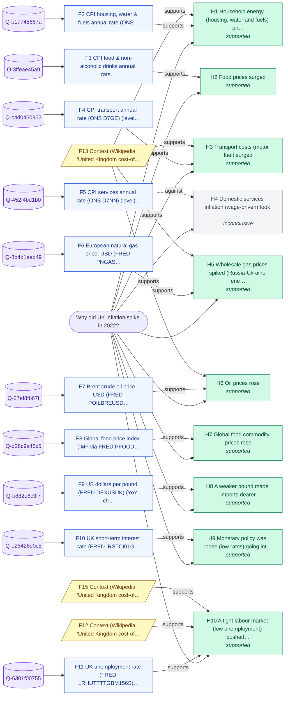

# Why did UK inflation spike in 2022?

_Backend: **zetaris-jdbc** · LLM: none · started 2026-10-23T09:03:41Z_

## Answer

UK inflation rose in 2022: 0.8 -> 11.1 (+10.2 pts, peak 2022-10). The evidence points mainly to (1) wholesale gas prices spiked (Russia-Ukraine energy shock); (2) household energy (housing, water and fuels) prices surged; (3) global food commodity prices rose.

**Confidence: High (0.94)** - 9 of 10 hypotheses supported; supported drivers cover ~97% of the move; 100% of queries returned data; 6 context corroborations.

## Because

- **Wholesale gas prices spiked (Russia-Ukraine energy shock)** - Moved 596.7 the expected way and co-moved with the target (r=+0.92, lead 9m). [F6, F13]
- **Household energy (housing, water and fuels) prices surged** - Moved 27.0 the expected way and co-moved with the target (r=+0.98, lead 0m). [F2, F13]
- **Global food commodity prices rose** - Moved 29.7 the expected way and co-moved with the target (r=+0.82, lead 9m). [F8]
- **Oil prices rose** - Moved 133.3 the expected way and co-moved with the target (r=+0.78, lead 9m). [F7, F13]
- **Food prices surged** - Moved 15.5 the expected way and co-moved with the target (r=+0.93, lead 0m). [F3]
- **Transport costs (motor fuel) surged** - Moved 14.6 the expected way and co-moved with the target (r=+0.96, lead 4m). [F4, F13]
- **A weaker pound made imports dearer** - Moved -18.1 the expected way and co-moved with the target (r=-0.64, lead 0m). [F9]
- **Monetary policy was loose (low rates) going into the spike** - Pre-spike conditions match the hypothesis (enabling factor, not a trigger). [F10]
- **A tight labour market (low unemployment) pushed wages up** - Pre-spike conditions match the hypothesis (enabling factor, not a trigger). [F11, F12, F15]

## Counter-evidence and limits

- Weak or no support: Domestic services inflation (wage-driven) took off. Moved the right way but weakly or without a consistent lead. [F5]

## Caveats

- Correlation over a short window is evidence of co-movement, not proof of causation; component weights are not applied.
- Context snippets from Wikipedia corroborate hypotheses but never supply numbers.

## Hypotheses tested

| # | Hypothesis | Test | Verdict | Detail |
|---|---|---|---|---|
| H1 | Household energy (housing, water and fuels) prices surged | CPI housing, water & fuels annual rate (ONS D7GB): direction & size of move vs 2020, and best lead correlation (lag 0-9m) | **supported** | Moved 27.0 the expected way and co-moved with the target (r=+0.98, lead 0m). |
| H2 | Food prices surged | CPI food & non-alcoholic drinks annual rate (ONS D7G8): direction & size of move vs 2020, and best lead correlation (lag 0-9m) | **supported** | Moved 15.5 the expected way and co-moved with the target (r=+0.93, lead 0m). |
| H3 | Transport costs (motor fuel) surged | CPI transport annual rate (ONS D7GE): direction & size of move vs 2020, and best lead correlation (lag 0-9m) | **supported** | Moved 14.6 the expected way and co-moved with the target (r=+0.96, lead 4m). |
| H4 | Domestic services inflation (wage-driven) took off | CPI services annual rate (ONS D7NN): direction & size of move vs 2020, and best lead correlation (lag 0-9m) | **inconclusive** | Moved the right way but weakly or without a consistent lead. |
| H5 | Wholesale gas prices spiked (Russia-Ukraine energy shock) | European natural gas price, USD (FRED PNGASEUUSDM): direction & size of move vs 2020, and best lead correlation (lag 0-9m) | **supported** | Moved 596.7 the expected way and co-moved with the target (r=+0.92, lead 9m). |
| H6 | Oil prices rose | Brent crude oil price, USD (FRED POILBREUSDM): direction & size of move vs 2020, and best lead correlation (lag 0-9m) | **supported** | Moved 133.3 the expected way and co-moved with the target (r=+0.78, lead 9m). |
| H7 | Global food commodity prices rose | Global food price index (IMF via FRED PFOODINDEXM): direction & size of move vs 2020, and best lead correlation (lag 0-9m) | **supported** | Moved 29.7 the expected way and co-moved with the target (r=+0.82, lead 9m). |
| H8 | A weaker pound made imports dearer | US dollars per pound (FRED DEXUSUK): direction & size of move vs 2020, and best lead correlation (lag 0-9m) | **supported** | Moved -18.1 the expected way and co-moved with the target (r=-0.64, lead 0m). |
| H9 | Monetary policy was loose (low rates) going into the spike | UK short-term interest rate (FRED IRSTCI01GBM156N): direction & size of move vs 2020, and best lead correlation (lag 0-9m) | **supported** | Pre-spike conditions match the hypothesis (enabling factor, not a trigger). |
| H10 | A tight labour market (low unemployment) pushed wages up | UK unemployment rate (FRED LRHUTTTTGBM156S): direction & size of move vs 2020, and best lead correlation (lag 0-9m) | **supported** | Pre-spike conditions match the hypothesis (enabling factor, not a trigger). |

## Evidence (every claim's source)

| # | Finding | Kind | Query · rows | Source |
|---|---|---|---|---|
| F1 | UK CPI annual rate (ONS D7G7): 11.1% in 2022-10 (the 2022 peak), vs a 2020 average of 0.8% (+10.2 pts) | data | `Q-adbf08cc42` · [57] | [link](https://www.ons.gov.uk/economy/inflationandpriceindices/timeseries/d7g7/mm23/data) |
| F2 | CPI housing, water & fuels annual rate (ONS D7GB) (level): -0.4% average in 2020; reached 26.6% in the 12 months to 2022-10; best correlation with the target r=+0.98 at a 0-month lead | data | `Q-b17745667a` · [45, 57] | [link](https://www.ons.gov.uk/economy/inflationandpriceindices/timeseries/d7gb/mm23/data) |
| F3 | CPI food & non-alcoholic drinks annual rate (ONS D7G8) (level): 0.7% average in 2020; reached 16.2% in the 12 months to 2022-10; best correlation with the target r=+0.93 at a 0-month lead | data | `Q-3ffeae45a9` · [45, 57] | [link](https://www.ons.gov.uk/economy/inflationandpriceindices/timeseries/d7g8/mm23/data) |
| F4 | CPI transport annual rate (ONS D7GE) (level): 0.3% average in 2020; reached 14.9% in the 12 months to 2022-10; best correlation with the target r=+0.96 at a 4-month lead | data | `Q-c4d0460962` · [45, 57] | [link](https://www.ons.gov.uk/economy/inflationandpriceindices/timeseries/d7ge/mm23/data) |
| F5 | CPI services annual rate (ONS D7NN) (level): 1.8% average in 2020; reached 6.3% in the 12 months to 2022-10; best correlation with the target r=+0.97 at a 0-month lead | data | `Q-452f4bd1b0` · [45, 57] | [link](https://www.ons.gov.uk/economy/inflationandpriceindices/timeseries/d7nn/mm23/data) |
| F6 | European natural gas price, USD (FRED PNGASEUUSDM) (YoY change): -24.2% average in 2020; reached 572.5% in the 12 months to 2022-10; best correlation with the target r=+0.92 at a 9-month lead | derived | `Q-8b4d1aad49` · [45, 57] | [link](https://fred.stlouisfed.org/graph/fredgraph.csv?id=PNGASEUUSDM) |
| F7 | Brent crude oil price, USD (FRED POILBREUSDM) (YoY change): -31.7% average in 2020; reached 101.6% in the 12 months to 2022-10; best correlation with the target r=+0.78 at a 9-month lead | derived | `Q-27ef8fb67f` · [45, 57] | [link](https://fred.stlouisfed.org/graph/fredgraph.csv?id=POILBREUSDM) |
| F8 | Global food price index (IMF via FRED PFOODINDEXM) (YoY change): 1.7% average in 2020; reached 31.4% in the 12 months to 2022-10; best correlation with the target r=+0.82 at a 9-month lead | derived | `Q-d28c9a45c5` · [45, 57] | [link](https://fred.stlouisfed.org/graph/fredgraph.csv?id=PFOODINDEXM) |
| F9 | US dollars per pound (FRED DEXUSUK) (YoY change): 0.6% average in 2020; reached -17.6% in the 12 months to 2022-10; best correlation with the target r=-0.64 at a 0-month lead | derived | `Q-b882e6c3f7` · [936, 1186] | [link](https://fred.stlouisfed.org/graph/fredgraph.csv?id=DEXUSUK) |
| F10 | UK short-term interest rate (FRED IRSTCI01GBM156N): averaged 0.18 in the 6-18 months before the 2022-10 peak (vs 0.19 in 2020); 2.19 at the peak | data | `Q-e25426e0c5` · [57] | [link](https://fred.stlouisfed.org/graph/fredgraph.csv?id=IRSTCI01GBM156N) |
| F11 | UK unemployment rate (FRED LRHUTTTTGBM156S): averaged 4.23 in the 6-18 months before the 2022-10 peak (vs 4.60 in 2020); 3.90 at the peak | data | `Q-6301f00755` · [57] | [link](https://fred.stlouisfed.org/graph/fredgraph.csv?id=LRHUTTTTGBM156S) |
| F12 | Context (Wikipedia, 'United Kingdom cost-of-living crisis'): By January 2024, the 12-month Retail Price Index had fallen to 4% after peaking at 11.1% in October 2022, while workers' wages had risen 6.2% in the last quarter of 2023. | context |  | [link](https://en.wikipedia.org/wiki/United_Kingdom_cost-of-living_crisis) |
| F13 | Context (Wikipedia, 'United Kingdom cost-of-living crisis'): Factors that have worsened the crisis since 1 April 2022 include Ofgem increasing the household energy price cap by 54%, an increase in National Insurance and a rise in Council Tax. | context |  | [link](https://en.wikipedia.org/wiki/United_Kingdom_cost-of-living_crisis) |
| F14 | Context (Wikipedia, 'United Kingdom cost-of-living crisis'): In 2022, household income – whether from earnings or benefits – had not generally kept pace with rising prices. | context |  | [link](https://en.wikipedia.org/wiki/United_Kingdom_cost-of-living_crisis) |
| F15 | Context (Wikipedia, 'United Kingdom cost-of-living crisis'): In April 2022, UK real wages fell by 4.5%, the sharpest fall since records began back in 2001. | context |  | [link](https://en.wikipedia.org/wiki/United_Kingdom_cost-of-living_crisis) |

## Queries run through the data harness

- `Q-adbf08cc42` (zetaris-jdbc, 72 rows) - UK CPI annual rate (ONS D7G7)
  ```sql
  SELECT period, value FROM because.ons_series_d7g7 WHERE period >= '2018-01' AND period <= '2023-12-31' ORDER BY period
  ```
  source: `because.ons_series_d7g7` <- https://www.ons.gov.uk/economy/inflationandpriceindices/timeseries/d7g7/mm23/data
- `Q-b17745667a` (zetaris-jdbc, 72 rows) - CPI housing, water & fuels annual rate (ONS D7GB)
  ```sql
  SELECT period, value FROM because.ons_series_d7gb WHERE period >= '2018-01' AND period <= '2023-12-31' ORDER BY period
  ```
  source: `because.ons_series_d7gb` <- https://www.ons.gov.uk/economy/inflationandpriceindices/timeseries/d7gb/mm23/data
- `Q-3ffeae45a9` (zetaris-jdbc, 72 rows) - CPI food & non-alcoholic drinks annual rate (ONS D7G8)
  ```sql
  SELECT period, value FROM because.ons_series_d7g8 WHERE period >= '2018-01' AND period <= '2023-12-31' ORDER BY period
  ```
  source: `because.ons_series_d7g8` <- https://www.ons.gov.uk/economy/inflationandpriceindices/timeseries/d7g8/mm23/data
- `Q-c4d0460962` (zetaris-jdbc, 72 rows) - CPI transport annual rate (ONS D7GE)
  ```sql
  SELECT period, value FROM because.ons_series_d7ge WHERE period >= '2018-01' AND period <= '2023-12-31' ORDER BY period
  ```
  source: `because.ons_series_d7ge` <- https://www.ons.gov.uk/economy/inflationandpriceindices/timeseries/d7ge/mm23/data
- `Q-452f4bd1b0` (zetaris-jdbc, 72 rows) - CPI services annual rate (ONS D7NN)
  ```sql
  SELECT period, value FROM because.ons_series_d7nn WHERE period >= '2018-01' AND period <= '2023-12-31' ORDER BY period
  ```
  source: `because.ons_series_d7nn` <- https://www.ons.gov.uk/economy/inflationandpriceindices/timeseries/d7nn/mm23/data
- `Q-8b4d1aad49` (zetaris-jdbc, 72 rows) - European natural gas price, USD (FRED PNGASEUUSDM)
  ```sql
  SELECT period, value FROM because.fred_series_pngaseuusdm WHERE period >= '2018-01' AND period <= '2023-12-31' ORDER BY period
  ```
  source: `because.fred_series_pngaseuusdm` <- https://fred.stlouisfed.org/graph/fredgraph.csv?id=PNGASEUUSDM
- `Q-27ef8fb67f` (zetaris-jdbc, 72 rows) - Brent crude oil price, USD (FRED POILBREUSDM)
  ```sql
  SELECT period, value FROM because.fred_series_poilbreusdm WHERE period >= '2018-01' AND period <= '2023-12-31' ORDER BY period
  ```
  source: `because.fred_series_poilbreusdm` <- https://fred.stlouisfed.org/graph/fredgraph.csv?id=POILBREUSDM
- `Q-d28c9a45c5` (zetaris-jdbc, 72 rows) - Global food price index (IMF via FRED PFOODINDEXM)
  ```sql
  SELECT period, value FROM because.fred_series_pfoodindexm WHERE period >= '2018-01' AND period <= '2023-12-31' ORDER BY period
  ```
  source: `because.fred_series_pfoodindexm` <- https://fred.stlouisfed.org/graph/fredgraph.csv?id=PFOODINDEXM
- `Q-b882e6c3f7` (zetaris-jdbc, 1496 rows) - US dollars per pound (FRED DEXUSUK)
  ```sql
  SELECT period, value FROM because.fred_series_dexusuk WHERE period >= '2018-01' AND period <= '2023-12-31' ORDER BY period
  ```
  source: `because.fred_series_dexusuk` <- https://fred.stlouisfed.org/graph/fredgraph.csv?id=DEXUSUK
- `Q-e25426e0c5` (zetaris-jdbc, 72 rows) - UK short-term interest rate (FRED IRSTCI01GBM156N)
  ```sql
  SELECT period, value FROM because.fred_series_irstci01gbm156n WHERE period >= '2018-01' AND period <= '2023-12-31' ORDER BY period
  ```
  source: `because.fred_series_irstci01gbm156n` <- https://fred.stlouisfed.org/graph/fredgraph.csv?id=IRSTCI01GBM156N
- `Q-6301f00755` (zetaris-jdbc, 72 rows) - UK unemployment rate (FRED LRHUTTTTGBM156S)
  ```sql
  SELECT period, value FROM because.fred_series_lrhuttttgbm156s WHERE period >= '2018-01' AND period <= '2023-12-31' ORDER BY period
  ```
  source: `because.fred_series_lrhuttttgbm156s` <- https://fred.stlouisfed.org/graph/fredgraph.csv?id=LRHUTTTTGBM156S

## Evidence graph



## Reasoning trace

1. **scout** - Intent explain.macro_series (band high, risk low); signed contract 001A1680071920000242E34305E
1. **recall** - H-MEM recalled 0 prior beliefs (minimal)
1. **plan** - Pull UK CPI annual rate (ONS D7G7) for 2018-2023, find the 2022 extreme, then test 10 candidate drivers
1. **findings** - Target 0.8 -> 11.1 (+10.2 pts, peak 2022-10)
1. **hypotheses** - Tested 10 drivers; 9 supported
1. **context** - Background search found 4 context snippets (context corroborates, never supplies numbers)
1. **remember** - Wrote 12 memories with provenance; 0 conflicts with prior beliefs
1. **done** - Finished in 5.3s

## Scout execution contract

Intent `explain.macro_series` (band high, risk low). Contract `001A1680071920000242E34305E`, capabilities ['background.search', 'harness.query', 'llm.narrate', 'memory.recall', 'memory.write'], expires 2026-10-23T09:08:41Z, HMAC `0b223bc3108bb42f…`.

_Wrote 12 memories with provenance; 0 conflicts with prior beliefs._
