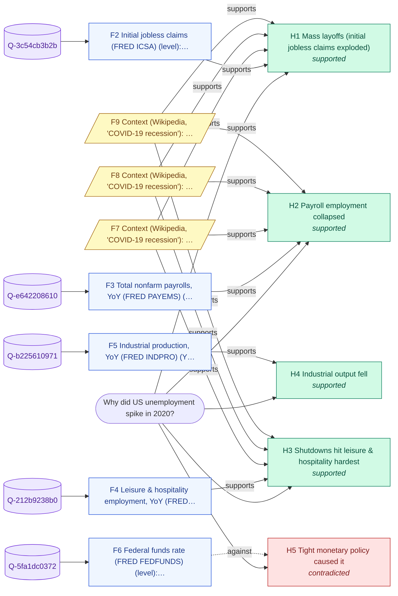

# Why did US unemployment spike in 2020?

_Backend: **zetaris-jdbc** · LLM: none · started 2026-10-23T09:03:54Z_

## Answer

US unemployment rose in 2020: 3.9 -> 14.8 (+10.9 pts, peak 2020-04). The evidence points mainly to (1) mass layoffs (initial jobless claims exploded); (2) shutdowns hit leisure & hospitality hardest; (3) industrial output fell.

**Confidence: High (0.91)** - 4 of 5 hypotheses supported; supported drivers cover ~100% of the move; 100% of queries returned data; 12 context corroborations; 1 hypotheses contradicted.

## Because

- **Mass layoffs (initial jobless claims exploded)** - Moved 4,443,796 the expected way and co-moved with the target (r=+0.99, lead 1m). [F2, F7, F8, F9, F10]
- **Shutdowns hit leisure & hospitality hardest** - Moved -48.7 the expected way and co-moved with the target (r=-0.97, lead 0m). [F4, F7, F8, F9, F10]
- **Industrial output fell** - Moved -20.5 the expected way and co-moved with the target (r=-0.76, lead 0m). [F5]
- **Payroll employment collapsed** - Moved -14.9 the expected way and co-moved with the target (r=-0.97, lead 0m). [F3, F7, F8, F9, F10]

## Counter-evidence and limits

- Not supported: Tight monetary policy caused it. Moved the other way (-1.8). [F6]

## Caveats

- Correlation over a short window is evidence of co-movement, not proof of causation; component weights are not applied.
- Context snippets from Wikipedia corroborate hypotheses but never supply numbers.

## Hypotheses tested

| # | Hypothesis | Test | Verdict | Detail |
|---|---|---|---|---|
| H1 | Mass layoffs (initial jobless claims exploded) | Initial jobless claims (FRED ICSA): direction & size of move vs 2018, and best lead correlation (lag 0-9m) | **supported** | Moved 4,443,796 the expected way and co-moved with the target (r=+0.99, lead 1m). |
| H2 | Payroll employment collapsed | Total nonfarm payrolls, YoY (FRED PAYEMS): direction & size of move vs 2018, and best lead correlation (lag 0-9m) | **supported** | Moved -14.9 the expected way and co-moved with the target (r=-0.97, lead 0m). |
| H3 | Shutdowns hit leisure & hospitality hardest | Leisure & hospitality employment, YoY (FRED USLAH): direction & size of move vs 2018, and best lead correlation (lag 0-9m) | **supported** | Moved -48.7 the expected way and co-moved with the target (r=-0.97, lead 0m). |
| H4 | Industrial output fell | Industrial production, YoY (FRED INDPRO): direction & size of move vs 2018, and best lead correlation (lag 0-9m) | **supported** | Moved -20.5 the expected way and co-moved with the target (r=-0.76, lead 0m). |
| H5 | Tight monetary policy caused it | Federal funds rate (FRED FEDFUNDS): direction & size of move vs 2018, and best lead correlation (lag 0-9m) | **contradicted** | Moved the other way (-1.8). |

## Evidence (every claim's source)

| # | Finding | Kind | Query · rows | Source |
|---|---|---|---|---|
| F1 | US unemployment rate (FRED UNRATE): 14.8% in 2020-04 (the 2020 peak), vs a 2018 average of 3.9% (+10.9 pts) | data | `Q-64a6b0cb32` · [51] | [link](https://fred.stlouisfed.org/graph/fredgraph.csv?id=UNRATE) |
| F2 | Initial jobless claims (FRED ICSA) (level): 219,454 average in 2018; reached 4,663,250 in the 12 months to 2020-04; best correlation with the target r=+0.99 at a 1-month lead | data | `Q-3c54cb3b2b` · [170, 222] | [link](https://fred.stlouisfed.org/graph/fredgraph.csv?id=ICSA) |
| F3 | Total nonfarm payrolls, YoY (FRED PAYEMS) (YoY change): 1.6% average in 2018; reached -13.4% in the 12 months to 2020-04; best correlation with the target r=-0.97 at a 0-month lead | derived | `Q-e642208610` · [39, 51] | [link](https://fred.stlouisfed.org/graph/fredgraph.csv?id=PAYEMS) |
| F4 | Leisure & hospitality employment, YoY (FRED USLAH) (YoY change): 1.5% average in 2018; reached -47.2% in the 12 months to 2020-04; best correlation with the target r=-0.97 at a 0-month lead | derived | `Q-212b9238b0` · [39, 51] | [link](https://fred.stlouisfed.org/graph/fredgraph.csv?id=USLAH) |
| F5 | Industrial production, YoY (FRED INDPRO) (YoY change): 3.2% average in 2018; reached -17.3% in the 12 months to 2020-04; best correlation with the target r=-0.76 at a 0-month lead | derived | `Q-b225610971` · [39, 51] | [link](https://fred.stlouisfed.org/graph/fredgraph.csv?id=INDPRO) |
| F6 | Federal funds rate (FRED FEDFUNDS) (level): 1.8% average in 2018; 0.1% at 2020-04; best correlation with the target r=+0.07 at a 9-month lead | data | `Q-5fa1dc0372` · [39, 51] | [link](https://fred.stlouisfed.org/graph/fredgraph.csv?id=FEDFUNDS) |
| F7 | Context (Wikipedia, 'COVID-19 recession'): The recession began in most countries in February 2020. | context |  | [link](https://en.wikipedia.org/wiki/COVID-19_recession) |
| F8 | Context (Wikipedia, 'COVID-19 recession'): After a year of global economic slowdown that saw stagnation of economic growth and consumer activity, the COVID-19 lockdowns and other precautions taken in early 2020 drove the global economy into crisis. | context |  | [link](https://en.wikipedia.org/wiki/COVID-19_recession) |
| F9 | Context (Wikipedia, 'COVID-19 recession'): The first major sign of recession was the 2020 stock market crash, which saw major indices drop 20 to 30% in late February and March. | context |  | [link](https://en.wikipedia.org/wiki/COVID-19_recession) |
| F10 | Context (Wikipedia, 'COVID-19 recession'): Recovery began in early April 2020; by April 2022, the GDP for most major economies had either returned to or exceeded pre-pandemic levels and many market indices recovered or even set new records by late 2020. | context |  | [link](https://en.wikipedia.org/wiki/COVID-19_recession) |

## Queries run through the data harness

- `Q-64a6b0cb32` (zetaris-jdbc, 72 rows) - US unemployment rate (FRED UNRATE)
  ```sql
  SELECT period, value FROM because.fred_series_unrate WHERE period >= '2016-01' AND period <= '2021-12-31' ORDER BY period
  ```
  source: `because.fred_series_unrate` <- https://fred.stlouisfed.org/graph/fredgraph.csv?id=UNRATE
- `Q-3c54cb3b2b` (zetaris-jdbc, 313 rows) - Initial jobless claims (FRED ICSA)
  ```sql
  SELECT period, value FROM because.fred_series_icsa WHERE period >= '2016-01' AND period <= '2021-12-31' ORDER BY period
  ```
  source: `because.fred_series_icsa` <- https://fred.stlouisfed.org/graph/fredgraph.csv?id=ICSA
- `Q-e642208610` (zetaris-jdbc, 72 rows) - Total nonfarm payrolls, YoY (FRED PAYEMS)
  ```sql
  SELECT period, value FROM because.fred_series_payems WHERE period >= '2016-01' AND period <= '2021-12-31' ORDER BY period
  ```
  source: `because.fred_series_payems` <- https://fred.stlouisfed.org/graph/fredgraph.csv?id=PAYEMS
- `Q-212b9238b0` (zetaris-jdbc, 72 rows) - Leisure & hospitality employment, YoY (FRED USLAH)
  ```sql
  SELECT period, value FROM because.fred_series_uslah WHERE period >= '2016-01' AND period <= '2021-12-31' ORDER BY period
  ```
  source: `because.fred_series_uslah` <- https://fred.stlouisfed.org/graph/fredgraph.csv?id=USLAH
- `Q-b225610971` (zetaris-jdbc, 72 rows) - Industrial production, YoY (FRED INDPRO)
  ```sql
  SELECT period, value FROM because.fred_series_indpro WHERE period >= '2016-01' AND period <= '2021-12-31' ORDER BY period
  ```
  source: `because.fred_series_indpro` <- https://fred.stlouisfed.org/graph/fredgraph.csv?id=INDPRO
- `Q-5fa1dc0372` (zetaris-jdbc, 72 rows) - Federal funds rate (FRED FEDFUNDS)
  ```sql
  SELECT period, value FROM because.fred_series_fedfunds WHERE period >= '2016-01' AND period <= '2021-12-31' ORDER BY period
  ```
  source: `because.fred_series_fedfunds` <- https://fred.stlouisfed.org/graph/fredgraph.csv?id=FEDFUNDS

## Evidence graph



## Reasoning trace

1. **scout** - Intent explain.macro_series (band high, risk low); signed contract 001A16800A36B000091F9358FC0
1. **recall** - H-MEM recalled 1 prior beliefs (minimal)
1. **plan** - Pull US unemployment rate (FRED UNRATE) for 2016-2021, find the 2020 extreme, then test 5 candidate drivers
1. **findings** - Target 3.9 -> 14.8 (+10.9 pts, peak 2020-04)
1. **hypotheses** - Tested 5 drivers; 4 supported
1. **context** - Background search found 4 context snippets (context corroborates, never supplies numbers)
1. **remember** - Wrote 7 memories with provenance; 0 conflicts with prior beliefs
1. **done** - Finished in 2.6s

## Scout execution contract

Intent `explain.macro_series` (band high, risk low). Contract `001A16800A36B000091F9358FC0`, capabilities ['background.search', 'harness.query', 'llm.narrate', 'memory.recall', 'memory.write'], expires 2026-10-23T09:08:54Z, HMAC `aa2881aac1601001…`.

## Recalled from memory (H-MEM)

- UK unemployment rate (FRED LRHUTTTTGBM156S): averaged 4.23 in the 6-18 months before the 2022-10 peak (vs 4.60 in 2020); 3.90 at the peak (score 0.4557, F11 of 'Why did UK inflation spike in 2022?')

_Wrote 7 memories with provenance; 0 conflicts with prior beliefs._
