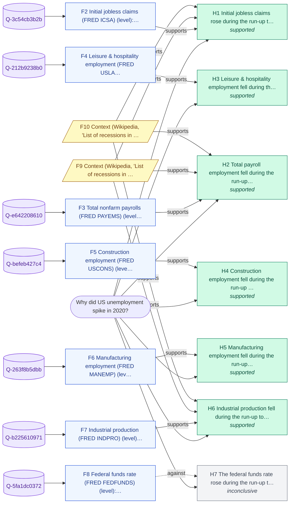

# Why did US unemployment spike in 2020?

_Backend: **zetaris-jdbc** · LLM: none · started 2026-10-23T12:02:39Z_

## Answer

US unemployment rose in 2020: 3.6% (2019-12) -> 14.8% (2020-04 peak), +11.2 pts; 2018 average 3.9%. The evidence is consistent with these drivers: (1) leisure & hospitality employment fell during the run-up to the 2020 peak; (2) initial jobless claims rose during the run-up to the 2020 peak; (3) industrial production fell during the run-up to the 2020 peak.

**Confidence: High (0.85)** - 6 of 7 hypotheses supported across 5 independent cause group(s); supported drivers carry ~100% of the tested evidence weight (de-duplicated by cause; this is not a share of the move); 100% of queries returned data; 6 context corroborations; macro answers are capped at 0.85 (no CPI weights applied).

## Because

- **Leisure & hospitality employment fell during the run-up to the 2020 peak** - Changed -48.1% over the same interval, the direction needed, and co-moved with the target (r=-1.00). Co-movement, not proof of cause. Context (not tested): in 2020 COVID-19 shutdowns closed restaurants, hotels and venues. [F4]
- **Initial jobless claims rose during the run-up to the 2020 peak** - Changed +2,110,850 over the same interval (its best lead, 1 month earlier), the direction needed, and co-moved with the target (r=+0.99). Co-movement, not proof of cause. Context (not tested): Claims count new layoffs filing for benefits. [F2, F9, F10]
- **Total payroll employment fell during the run-up to the 2020 peak** - Changed -14.1% over the same interval, the direction needed, and co-moved with the target (r=-0.91). Co-movement, not proof of cause. [F3, F9, F10]
- **Industrial production fell during the run-up to the 2020 peak** - Changed -16.9% over the same interval, the direction needed, and co-moved with the target (r=-0.91). Co-movement, not proof of cause. [F7, F9, F10]
- **Manufacturing employment fell during the run-up to the 2020 peak** - Changed -10.8% over the same interval, the direction needed, and co-moved with the target (r=-0.87). Co-movement, not proof of cause. [F6]
- **Construction employment fell during the run-up to the 2020 peak** - Changed -13.4% over the same interval, the direction needed, and co-moved with the target (r=-0.59). Co-movement, not proof of cause. Context (not tested): Construction is cyclical and sensitive to housing demand and credit. [F5]

## Counter-evidence and limits

- Correlation is not causation: each supported driver moved the needed way over the same interval and co-moved with the target, which is consistent with it contributing but does not prove it did; component weights are not applied. [F1]
- Weak or no support: The federal funds rate rose during the run-up to the 2020 peak. Change of -0.0 pts is below the materiality threshold (0.25 pts). [F8]

## Caveats

- The move is measured from December of the prior year to the in-year extreme; drivers are tested over the same interval.
- Correlation over a short window is evidence of co-movement, not proof of causation; component weights are not applied.
- Context notes are background mechanisms; they are not tested and never supply numbers.
- Context snippets from Wikipedia corroborate hypotheses but never supply numbers.

## Hypotheses tested

| # | Hypothesis | Test | Verdict | Detail |
|---|---|---|---|---|
| H1 | Initial jobless claims rose during the run-up to the 2020 peak | Initial jobless claims (FRED ICSA): sign and size of its change over the target's 2019-12 -> 2020-04 interval (shifted by its best lead of 0-9 months), and lead correlation r >= 0.5 | **supported** | Changed +2,110,850 over the same interval (its best lead, 1 month earlier), the direction needed, and co-moved with the target (r=+0.99). Co-movement, not proof of cause. |
| H2 | Total payroll employment fell during the run-up to the 2020 peak | Total nonfarm payrolls (FRED PAYEMS): sign and size of its change over the target's 2019-12 -> 2020-04 interval (shifted by its best lead of 0-9 months), and lead correlation r >= 0.5 | **supported** | Changed -14.1% over the same interval, the direction needed, and co-moved with the target (r=-0.91). Co-movement, not proof of cause. |
| H3 | Leisure & hospitality employment fell during the run-up to the 2020 peak | Leisure & hospitality employment (FRED USLAH): sign and size of its change over the target's 2019-12 -> 2020-04 interval (shifted by its best lead of 0-9 months), and lead correlation r >= 0.5 | **supported** | Changed -48.1% over the same interval, the direction needed, and co-moved with the target (r=-1.00). Co-movement, not proof of cause. |
| H4 | Construction employment fell during the run-up to the 2020 peak | Construction employment (FRED USCONS): sign and size of its change over the target's 2019-12 -> 2020-04 interval (shifted by its best lead of 0-9 months), and lead correlation r >= 0.5 | **supported** | Changed -13.4% over the same interval, the direction needed, and co-moved with the target (r=-0.59). Co-movement, not proof of cause. |
| H5 | Manufacturing employment fell during the run-up to the 2020 peak | Manufacturing employment (FRED MANEMP): sign and size of its change over the target's 2019-12 -> 2020-04 interval (shifted by its best lead of 0-9 months), and lead correlation r >= 0.5 | **supported** | Changed -10.8% over the same interval, the direction needed, and co-moved with the target (r=-0.87). Co-movement, not proof of cause. |
| H6 | Industrial production fell during the run-up to the 2020 peak | Industrial production (FRED INDPRO): sign and size of its change over the target's 2019-12 -> 2020-04 interval (shifted by its best lead of 0-9 months), and lead correlation r >= 0.5 | **supported** | Changed -16.9% over the same interval, the direction needed, and co-moved with the target (r=-0.91). Co-movement, not proof of cause. |
| H7 | The federal funds rate rose during the run-up to the 2020 peak | Federal funds rate (FRED FEDFUNDS): sign and size of its change over the target's 2019-12 -> 2020-04 interval (shifted by its best lead of 0-9 months), and lead correlation r >= 0.5 | **inconclusive** | Change of -0.0 pts is below the materiality threshold (0.25 pts). |

## Evidence (every claim's source)

| # | Finding | Kind | Query · rows | Source |
|---|---|---|---|---|
| F1 | US unemployment rate (FRED UNRATE): 3.6% in 2019-12 (start of 2020) -> 14.8% in 2020-04 (the 2020 peak), +11.2 pts; for context, the 2018 average was 3.9% | data | `Q-64a6b0cb32` · [47, 51] | [link](https://fred.stlouisfed.org/graph/fredgraph.csv?id=UNRATE) |
| F2 | Initial jobless claims (FRED ICSA) (level): 224,400 in 2019-11 -> 2,335,250 in 2020-03 (its best lead, 1 month earlier), a change of +2,110,850; correlation with the target r=+0.99 at a 1-month lead | data | `Q-3c54cb3b2b` · [165, 200, 218] | [link](https://fred.stlouisfed.org/graph/fredgraph.csv?id=ICSA) |
| F3 | Total nonfarm payrolls (FRED PAYEMS) (level): 151,794 in 2019-12 -> 130,426 in 2020-04, a change of -14.1%; correlation with the target r=-0.91 at a 0-month lead | data | `Q-e642208610` · [39, 47, 51] | [link](https://fred.stlouisfed.org/graph/fredgraph.csv?id=PAYEMS) |
| F4 | Leisure & hospitality employment (FRED USLAH) (level): 16,805 in 2019-12 -> 8,719 in 2020-04, a change of -48.1%; correlation with the target r=-1.00 at a 0-month lead | data | `Q-212b9238b0` · [39, 47, 51] | [link](https://fred.stlouisfed.org/graph/fredgraph.csv?id=USLAH) |
| F5 | Construction employment (FRED USCONS) (level): 7,527 in 2019-12 -> 6,522 in 2020-04, a change of -13.4%; correlation with the target r=-0.59 at a 0-month lead | data | `Q-befeb427c4` · [39, 47, 51] | [link](https://fred.stlouisfed.org/graph/fredgraph.csv?id=USCONS) |
| F6 | Manufacturing employment (FRED MANEMP) (level): 12,760 in 2019-12 -> 11,382 in 2020-04, a change of -10.8%; correlation with the target r=-0.87 at a 0-month lead | data | `Q-263f8b5dbb` · [39, 47, 51] | [link](https://fred.stlouisfed.org/graph/fredgraph.csv?id=MANEMP) |
| F7 | Industrial production (FRED INDPRO) (level): 101.7 in 2019-12 -> 84.6 in 2020-04, a change of -16.9%; correlation with the target r=-0.91 at a 0-month lead | data | `Q-b225610971` · [39, 47, 51] | [link](https://fred.stlouisfed.org/graph/fredgraph.csv?id=INDPRO) |
| F8 | Federal funds rate (FRED FEDFUNDS) (level): 2.4% in 2019-03 -> 2.4% in 2019-07 (its best lead, 9 months earlier), a change of -0.0 pts; correlation with the target r=+0.07 at a 9-month lead | data | `Q-5fa1dc0372` · [30, 38, 42] | [link](https://fred.stlouisfed.org/graph/fredgraph.csv?id=FEDFUNDS) |
| F9 | Context (Wikipedia, 'List of recessions in the United States'): Before the COVID-19 recession began in March 2020, no post-World War II era had come anywhere near the depth of the Great Depression, which lasted from 1929 until 1941 (which included a bull market between 1933 and 1937) and was caused by the 1929 crash of the stock market and other factors. | context |  | [link](https://en.wikipedia.org/wiki/List_of_recessions_in_the_United_States) |
| F10 | Context (Wikipedia, 'List of recessions in the United States'): Until the start of the COVID-19 recession in 2020, no post-World War II era came anywhere near the depth of the Great Depression. | context |  | [link](https://en.wikipedia.org/wiki/List_of_recessions_in_the_United_States) |

## Queries run through the data harness

- `Q-64a6b0cb32` (zetaris-jdbc, 72 rows) - US unemployment rate (FRED UNRATE)
  ```sql
  SELECT period, value FROM because.fred_series_unrate WHERE period >= '2016-01' AND period <= '2021-12-31' ORDER BY period
  ```
  source: `because.fred_series_unrate` <- https://fred.stlouisfed.org/graph/fredgraph.csv?id=UNRATE
- `Q-3c54cb3b2b` (zetaris-jdbc, 313 rows) - Initial jobless claims (FRED ICSA)
  ```sql
  SELECT period, value FROM because.fred_series_icsa WHERE period >= '2016-01' AND period <= '2021-12-31' ORDER BY period
  ```
  source: `because.fred_series_icsa` <- https://fred.stlouisfed.org/graph/fredgraph.csv?id=ICSA
- `Q-e642208610` (zetaris-jdbc, 72 rows) - Total nonfarm payrolls (FRED PAYEMS)
  ```sql
  SELECT period, value FROM because.fred_series_payems WHERE period >= '2016-01' AND period <= '2021-12-31' ORDER BY period
  ```
  source: `because.fred_series_payems` <- https://fred.stlouisfed.org/graph/fredgraph.csv?id=PAYEMS
- `Q-212b9238b0` (zetaris-jdbc, 72 rows) - Leisure & hospitality employment (FRED USLAH)
  ```sql
  SELECT period, value FROM because.fred_series_uslah WHERE period >= '2016-01' AND period <= '2021-12-31' ORDER BY period
  ```
  source: `because.fred_series_uslah` <- https://fred.stlouisfed.org/graph/fredgraph.csv?id=USLAH
- `Q-befeb427c4` (zetaris-jdbc, 72 rows) - Construction employment (FRED USCONS)
  ```sql
  SELECT period, value FROM because.fred_series_uscons WHERE period >= '2016-01' AND period <= '2021-12-31' ORDER BY period
  ```
  source: `because.fred_series_uscons` <- https://fred.stlouisfed.org/graph/fredgraph.csv?id=USCONS
- `Q-263f8b5dbb` (zetaris-jdbc, 72 rows) - Manufacturing employment (FRED MANEMP)
  ```sql
  SELECT period, value FROM because.fred_series_manemp WHERE period >= '2016-01' AND period <= '2021-12-31' ORDER BY period
  ```
  source: `because.fred_series_manemp` <- https://fred.stlouisfed.org/graph/fredgraph.csv?id=MANEMP
- `Q-b225610971` (zetaris-jdbc, 72 rows) - Industrial production (FRED INDPRO)
  ```sql
  SELECT period, value FROM because.fred_series_indpro WHERE period >= '2016-01' AND period <= '2021-12-31' ORDER BY period
  ```
  source: `because.fred_series_indpro` <- https://fred.stlouisfed.org/graph/fredgraph.csv?id=INDPRO
- `Q-5fa1dc0372` (zetaris-jdbc, 72 rows) - Federal funds rate (FRED FEDFUNDS)
  ```sql
  SELECT period, value FROM because.fred_series_fedfunds WHERE period >= '2016-01' AND period <= '2021-12-31' ORDER BY period
  ```
  source: `because.fred_series_fedfunds` <- https://fred.stlouisfed.org/graph/fredgraph.csv?id=FEDFUNDS

## Evidence graph



## Reasoning trace

1. **scout** - Intent explain.macro_series (band high, risk low); signed contract 001A168A448D000000A9E5C343B
1. **recall** - H-MEM recalled 1 prior beliefs (minimal)
1. **plan** - Pull US unemployment rate (FRED UNRATE) for 2016-2021; measure the move from Dec 2019 to the 2020 extreme; test 7 candidate drivers over the same interval
1. **findings** - Target 3.6 (2019-12) -> 14.8 (2020-04), +11.2 pts: up
1. **hypotheses** - Tested 7 drivers; 6 supported across 5 cause groups
1. **context** - Background search found 2 context snippets (context corroborates, never supplies numbers)
1. **cross-source** - Cross-source join skipped: no second source family configured for unemployment/US
1. **remember** - Wrote 9 memories with provenance; 0 conflicts with prior beliefs
1. **done** - Finished in 2.3s

## Scout execution contract

Intent `explain.macro_series` (band high, risk low). Contract `001A168A448D000000A9E5C343B`, capabilities ['background.search', 'harness.query', 'llm.narrate', 'memory.recall', 'memory.write'], expires 2026-10-23T12:07:39Z, HMAC `8954fe9b1c337515…`.

## Recalled from memory (H-MEM)

- UK unemployment rate (FRED LRHUTTTTGBM156S): averaged 4.23 in the 6-18 months before the 2022-10 peak (vs 4.60 in 2020); 3.90 at 2022-10 (score 0.4524, F11 of 'Why did UK inflation spike in 2022?')

_Wrote 9 memories with provenance; 0 conflicts with prior beliefs._
